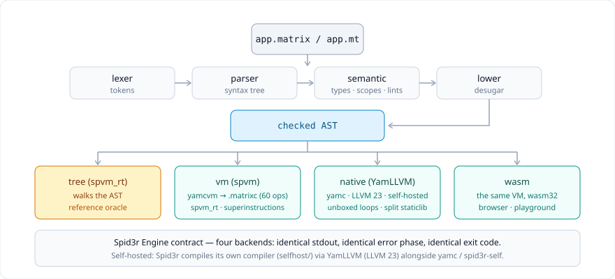
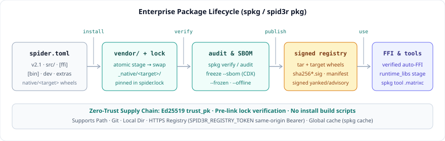
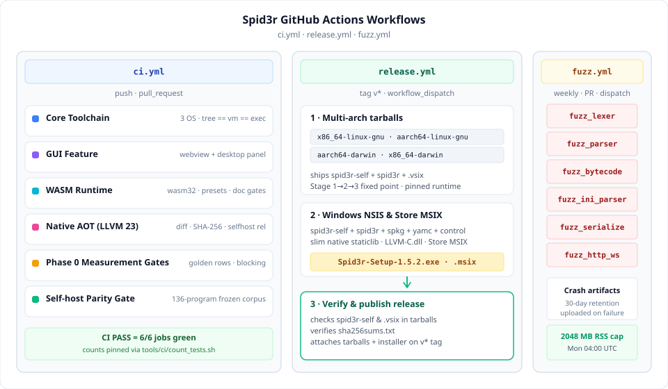

# Spid3r

**One front end. Four backends. Zero runtime dependencies.**

A programming language whose interpreters and compilers are required to agree with each other.



```spid3r
fn main() {
    println("Hello, Spid3r!");
    return 0;
}
```

```bash
$ spid3r run hello.matrix
Hello, Spid3r!
```

## How it works

Source goes through **one** front end — lexer, parser, semantic checker, lowering — and stops at a checked AST. Everything after that is a backend, and no backend may reinterpret the language.

- **The tree walker is the oracle.** When engines disagree, the plain AST interpreter defines what is correct.
- **The VM compiles to 60 opcodes** with a peephole optimizer. `--no-opt` exists so the optimizer can be tested against itself. The optimizer also rotates `while` loop back-edges so steady-state iterations skip one unconditional jump; that transform runs only on the default path, changes no opcode and no `.matrixc` format, and is covered by `OptStats.rotations`. The dispatch loop separately fuses a few hot opcode patterns at run time; those fusions read the existing bytes, add no opcode and run only on the default optimized VM path. `--no-opt` now disables them together with the compile-time passes (`Vm::set_opt_enabled(false)`), and `--prof`, `--coverage`, the debugger or captured locals disable them so every original instruction stays observable. Per-VM inline caches remain enabled under `--no-opt` because they are memoization, not instruction peeks.
- **Native is real machine code** via LLVM — not a bundled interpreter wearing an `.exe`.
- **WebAssembly is the same VM**, compiled to wasm32.

Every backend must produce identical **stdout**, identical **error phase**, and identical **exit code**. `spid3r test` checks the three native engines on every run; CI holds the WebAssembly build to the same bar.

## Memory


Values are reference counted, so ordinary garbage dies the moment it is dropped. Cycles cannot, so a tracing mark-and-sweep collector reclaims them. `gc_collect()` and `gc_live_cells()` are builtins on every engine.

## Ship it five ways


Prebuilt releases bundle **`spid3r-self`** (the self-hosted native compiler & dev CLI) alongside **`spid3r`** (the core interpreter, bytecode VM, REPL, LSP, debugger, agent, and host-plugin runtime) plus the versioned, SHA-256-pinned runtime archive (`spid3r-runtime-<ver>-<target>.tar.gz`). Backend caveats:

- **Core CLI (`spid3r` VM / interpreter / REPL):** zero external runtime dependencies.
- **GUI:** needs the OS webview — WebView2 (preinstalled on Windows 10/11; the installer can bundle its bootstrapper) or WebKit2GTK + GTK3 on Linux (`libwebkit2gtk-4.1-dev` at build time, `webkit2gtk` runtime package to run).
- **Native AOT (`spid3r build` / `spid3r-self`):** needs LLVM 23.1+ — built executables are standalone (`static CRT` on Windows). On Windows the toolchain & NSIS installer bundle `LLVM-C.dll` + `LLVM-C.lib` + `spid3r_lang.lib`; on Linux/macOS native AOT builds link `libLLVM-23` at compiler runtime.

## Ecosystem


Third-party code reaches a program through seven routes, and only one of them can be sandboxed.



**Packages** ship today. A package is a `spider.toml` plus a `src/` tree; `spid3r add` declares and vendors it, `spid3r tree` shows what that resolved to, and `spid3r verify` re-hashes every vendored file against `spider.lock` so a hand-edited dependency fails instead of compiling. `spid3r publish --to-dir` writes `<dir>/<name>/<version>/` (`spider.toml`, `src/`, `package.tar`, `sha256.txt`, and detached Ed25519 signature `sha256.txt.sig`) plus `<dir>/<name>/index.txt` and `<dir>/registry.pub`. `spid3r install` resolves `path`, `git`, local-directory, and remote `http(s)://` registries (`SPID3R_REGISTRY` / `packages.registry`), **requires** `sha256.txt` for registry packages, verifies `sha256.txt.sig` under `packages.trust_pk` / `SPID3R_TRUST_PK` (or `registry.pub`), and unifies compatible semver constraints across diamond dependency graphs. No build scripts — installing a package never executes its code.


**Host plugins work.** A plugin declares itself in a `plugin.toml` (exact-match ABI string, one block per function with its arity and permission), implements one trait, and is registered by its host at startup. Registration merges its functions into the native table all three engines already read, so a plugin function needs no per-engine code. There is no dynamic loading: a plugin is compiled into its host, because a native function is a Rust pointer over `Value` and `Value` has no stable C representation.

A *host* plugin is trusted code — same address space, same authority, and no capability filter can revoke that. Its declared permission is what lets a host stop a *script* from calling it.

**WASM plugins are the sandboxed route**, and they need no rebuild: `spid3r run` discovers `plugin.toml` + `plugin.wasm` on the plugin search path and interprets the module. The host links an empty linker, so a guest that imports anything — a file, a clock, a socket — fails to instantiate. Nothing is revoked at run time because nothing was ever granted, and a fuel budget means a `loop {}` traps instead of hanging.

```console
$ SPID3R_PLUGINS=examples/plugins spid3r run examples/plugins/hello-wasm/demo.matrix
Hello, Ada! (from wasm)
42
```

`spid3r build` refuses a program that calls a plugin function: a standalone native executable cannot link one, and that is a compile-time error rather than a binary that throws at run time.

```rust
spid3r_lang::plugin::register(Box::new(HelloPlugin::new()))?;
```

Both samples are in the repository: [`hello-host`](examples/plugins/hello-host) (compiled in) and [`hello-wasm`](examples/plugins/hello-wasm) (sandboxed).

| Route | Trust | Status |
|---|---|---|
| Embedded stdlib | immutable, compiled in | shipped |
| Project `.matrix` files | your own source | shipped |
| Spid3r plugins (`kind = "matrix"`) | written in the language, script trust | shipped |
| Vendored packages | checksummed, re-checked by `spid3r verify` | shipped |
| WASM plugins | sandboxed, loaded from disk | shipped |
| Host plugins | trusted code, not sandboxable | shipped |
| FFI (`extern fn`) | trusted code, AOT only | shipped |

```bash
$ spid3r modules app.matrix --tree        # which file does each import name?
$ spid3r verify                           # is the vendored tree the one the lock describes?
```


By default a program runs with the full authority of the user who started it. `spid3r run --sandbox` and `spid3r exec --sandbox` opt into a capability gate — filesystem, network, process and environment access are refused with catchable `sandboxed: ... denied` errors, enforced through the single native funnel every engine installs from, so an imported module cannot re-arm what was denied. When embedding in Rust, `Engine::deny` applies the same policy. It is a policy filter over built-in natives, not an OS-level sandbox.


`spid3r.ini` carries the runtime configuration — precedence layers, the encrypted `spid3r-agent/1` wire protocol, role-checked predefined operations, the audit log, and atomic config saves. See [Runtime management](docs/AGENT.md) for the full contract.



Every commit and tag is gated through GitHub Actions workflows: a 6-job differential CI matrix (core, webview GUI, WebAssembly runtime & docs, LLVM 23 native AOT + Linux self-host bootstrap, Phase 0 measurement gates, and the 134-program frozen-corpus self-host parity gate), automated self-hosted multi-architecture releases (Linux glibc/ARM64 tarballs, macOS Apple Silicon/Intel tarballs, SHA-256-pinned runtime archives, and the Windows NSIS installer packaging `spid3r-self`), and scheduled/PR libfuzzer regression testing.

## Self-hosted compiler architecture

Spid3r compiles its own compiler and core CLI developer tools (`selfhost/`, 17 compiler/tool modules across 21 `.matrix` files) to native machine code via LLVM 23:


Rebuilding `selfhost/` or running compiler/dev CLI workflows (`tokens`, `parse`, `check`, `compile`, `build`, `test`, `fmt`, `pack`/`unpack`/`verify`/`dist`, `verify-runtime`) uses `spid3r-self` with zero `cargo` or `rustc` calls. Rust Stage 0 (`src/`) stays permanently as the cold bootstrap seed, differential parity oracle, SHA-256-pinned runtime staticlib (`spid3r_lang`), and host for the retained runtime/tooling surfaces (`tree`, `vm`, `repl`, `debug`, `lsp`, `agent`, `gui`, `wasm32`, `plugin`):


See [docs/selfhost/](docs/selfhost/README.md) for the full ADR, retirement boundary, and runtime ABI docs.

## What's inside

| Aspect | Detail |
|---|---|
| **Implementation** | `102,312` lines of Rust (`src/`, zero dependencies in `--no-default-features`) + `17` self-hosted compiler & CLI modules (`selfhost/`, `21` `.matrix` files / `19,304` lines) |
| **Engines** | tree · bytecode VM · LLVM 23 AOT · WebAssembly |
| **Bytecode** | 60 opcodes · serialized `.matrixc` container with SHA-256 integrity |
| **Standard library** | `29` `.matrix` modules + `257` built-in native entries (linked via `70` AOT C-ABI trampolines) |
| **Tests** | `1,394` Rust/integration tests (`1,367` core · `13` GUI · `14` native AOT) · three-engine differential + `134`-program frozen selfhost corpus |
| **Self-hosting** | Stage 1 → Stage 2 → Stage 3 COFF/ELF `spid3r_main.o` bit-identical fixed point, SHA-256 runtime pinning, and frozen-corpus parity ([docs/selfhost/](docs/selfhost/README.md) · [SELFHOST.md](docs/selfhost/SELFHOST.md) · [SELFHOST_RETIREMENT.md](docs/selfhost/SELFHOST_RETIREMENT.md)) |
| **Benchmarks** | Phase 11 compute reference (`VM`, `native`, `Node.js`, `Rust -O`) & Stage-0 vs selfhost throughput baselines ([benchmark.html](docs/html/benchmark.html) · [selfhost baselines](benchmarks/selfhost/README.md)) |
| **Binary** | `spid3r` (`~12.4 MB`) + self-hosted `spid3r-self` (`~5.1 MB`) · static CRT on Windows · runs with no installed runtime |

## The language

```spid3r
interface Greetable {
    public fn greet(self) -> string { return "Hi, " + self.name; }
}

class User implements Greetable {
    public let name: string;
    fn new(name: string) { self.name = name; }
    public static fn guest() { return new User("Guest"); }
}

fn main() {
    let u = User("Ada");
    let scores = { "math": 95, "cs": 100 };
    let doubled = [1, 2, 3].map(x => x * 2);
    println(u.greet() + " / cs=" + string(scores["cs"]) + " / " + string(doubled));
    return 0;
}
```

Types are optional (including nullable `T?` and union `int | string` annotations) with flow-sensitive nullability narrowing (`if x != null`, `?`, `?.`, `while`) and scrutinee-driven enum `match` exhaustiveness. Classes with `static fn` methods, interfaces with default method bodies, selective cross-module imports (`import { A, B as C } from "mod"`), arrow closures (`x => expr`), map literals (`{ "k": v }`), raw strings (`r"..."`), `try`/`catch`, `spawn` and channels, 20+ native containers, vectors and matrices, and `E1xxx` diagnostics — all in the core.

## Install

```bash
# Linux / macOS
curl -fsSL https://raw.githubusercontent.com/needyamin/spid3r/main/install.sh | sh

# From source: core only, no LLVM and no system libraries
cargo install --path . --no-default-features
```

**Windows:** run `Spid3r-Setup-<version>.exe` from the latest release (installs `spid3r-self`, `spid3r`, `spid3r-control`, bundled LLVM, and the SHA-256-pinned runtime; `install.sh` installs `spid3r-self` alongside `spid3r` on Linux/macOS).

## Toolchain

| Command | Does |
|---|---|
| `spid3r run app.matrix` | execute on the VM (`--engine tree` oracle, `--prof` opcode + per-function self-time) |
| `spid3r check` | types, scopes, flow narrowing, enum exhaustiveness, lints, multi-error recovery (`E1xxx`) — no execution |
| `spid3r repl` | interactive shell with TTY cursor editing & history (non-TTY `read_line` fallback) |
| `spid3r debug --break 12` | breakpoints, stepping, backtrace, locals |
| `spid3r fmt --check` | canonical formatting, exits 1 on drift |
| `spid3r doc [--json] [--private] [-o PATH]` | generate HTML or JSON documentation from source doc comments |
| `spid3r test` | differential run across engines |
| `spid3r lsp` | editor server: diagnostics, hover, rename, actions |
| `spid3r build` | native executable |
| `spid3r bundle --target wasm` | offline web app |
| `spid3r init` · `install` · `dist` | projects, dependencies, release build |
| `spid3r add` · `remove` · `tree` · `verify` | declare, inspect and check dependencies |
| `spid3r modules` · `publish` · `search` | module origins, registry entries |
| `spid3r magic <cmd>` | run project-root `magic` framework CLI from any subdirectory |
| `spid3r compile` · `gui` · `exec` · `bench` | bytecode file, windowed app, script runner, benchmarks |
| `spid3r disasm app.matrixc` | human-readable bytecode disassembly (exit 4 on a corrupt file) |
| `spid3r plugin` · `pack` · `unpack` · `verify-runtime` | plugin inspection, tar+sha256 archive, extract, runtime ABI/hash check |
| `spid3r info` · `config` · `agent` · `admin` | build info, settings, management agent |
| `spid3r config validate` | validate `spid3r.ini`; reports value problems and an explicitly broken `SPID3R_INI` pin (exit 1); unknown flags are usage errors (exit 2) |
| `spid3r config init [PATH] [--force]` | write a commented default ini; refuses to overwrite an existing file without `--force` (`--help` prints usage instead of writing a file) |
| `spid3r control config validate` | agent-side validation; exits 1 and prints errors to stderr when the config is invalid |

**Configuration.** One `spid3r.ini` is the control plane. `SPID3R_INI` is **authoritative**: when it is set and non-empty it is the only ini candidate. If that path is missing or unreadable the loader uses compiled defaults only (it never falls through to the machine or working-directory ini), records a typed pin failure that `config validate`, `control status` and local `info` surface, and every program-executing command (`run`, `check`, `compile`, `exec`, `test`, `bench`, `debug`, `gui`, `repl`, `magic`) refuses to start with exit 1. `--version`, `help`, `info`, `config path` and `config validate` remain usable to diagnose the pin, and remote `config.set` refuses to persist while it is broken — the local `control config set` / `spid3r config init` paths are how an operator repairs it. If a long-lived process already initialized its runtime policy while the pin was broken, restart that process after repair; it keeps a fail-closed policy until restart. Local `spid3rinfo()` reports the configuration notes and broken-pin status; remote introspection omits those host-specific diagnostics.

### Exit codes

| Code | Meaning |
|---|---|
| 0 | success |
| 1 | program error (compile failure or runtime failure) |
| 2 | usage error (unknown command or bad arguments) |
| 4 | invalid bytecode (corrupt or malformed `.matrixc`) |

`spid3r run --budget` (alias `--max-steps`) caps the work untrusted code may do; `--max-call-depth` caps recursion and applies to the tree and VM engines; the AOT backend enforces the same 1000-depth limit with the identical diagnostic (verified on a compiled `r(1500)`), but does not enforce an execution budget — run untrusted code on the tree or VM engines. `spid3r run --sandbox` and `spid3r exec --sandbox` deny file-system, network, process and environment access to the program (catchable `sandboxed: ... denied` errors). `.matrixc` files written by `spid3r compile` carry a SHA-256 integrity checksum, verified on load: a corrupt or modified file exits 4 with `bytecode integrity check failed`. That checksum is an integrity check (bit rot, corruption, lazy tampering), **not** an authenticity control — anyone can recompute it; signing distributed bytecode (e.g. with the in-tree Ed25519 implementation) is a noted future direction. AOT-produced executables report runtime failures with their own process conventions and are not bound by this table.

`spid3r config validate` prints problems and exits 1 when any are found, 0 when clean; this includes an explicitly broken `SPID3R_INI` pin. Unknown flags are usage errors (exit 2). `spid3r control config validate` exits 1 and writes its errors to stderr when the config is invalid. A broken `SPID3R_INI` pin blocks program execution with exit 1 (see Configuration above). These are the same 0/1/2/4 codes — no renumbering.

## Documentation

| Guide | What's in it |
|---|---|
| [Developer guide](docs/html/doc.html) | 15-chapter tutorial, API reference, runnable samples |
| [Benchmarks](docs/html/benchmark.html) · [Selfhost baselines](benchmarks/selfhost/README.md) | gated VM/tree/PHP/Python tables, Phase 11 `P-1` (`VM`, `native`, `Node`, `Rust`) & `P-2` Stage-0 vs selfhost throughput |
| [Plugin guide](docs/html/plugin.html) · [ABI v1](docs/PLUGIN_ABI.md) | how to write a plugin · the contract, and what forces a v2 |
| [Playground](docs/html/playground.html) | run Spid3r in the browser |
| [Grammar](docs/GRAMMAR.md) | EBNF and precedence |
| [Standard library](docs/STANDARD_LIBRARY.md) | every builtin and module |
| [Ecosystem](docs/ECOSYSTEM.md) · [Registry](docs/REGISTRY.md) | packages, plugins, trust model · publishing |
| [Data structures](docs/DATA_STRUCTURES.md) | all 20+ containers |
| [Bytecode & VM](docs/BYTECODE.md) | `.matrixc` format, opcodes, scheduler |
| [Garbage collection](docs/GC.md) | cycle collector design |
| [Native backend](docs/NATIVE.md) · [Runtime ABI](docs/selfhost/RUNTIME_ABI.md) · [FFI](docs/FFI.md) | LLVM AOT · SHA-256 runtime staticlib contract · calling C with `extern fn` |
| [GUI](docs/GUI.md) · [Embedding](docs/EMBEDDING.md) | desktop apps · Rust host |
| [Environment](docs/ENVIRONMENT.md) | every `SPID3R_*` knob |
| [Runtime management](docs/AGENT.md) | `spid3r.ini`, `spid3rinfo()`, the encrypted remote agent |
| [Security policy](SECURITY.md) | trust model, reporting, known gaps |
| [Audit status](docs/AUDIT_STATUS.md) | known issues and their state |
| [Self-hosting docs & diagrams](docs/selfhost/README.md) · [ADR](docs/selfhost/SELFHOST.md) · [Retirement review](docs/selfhost/SELFHOST_RETIREMENT.md) | bootstrap stages, architecture diagrams, frozen corpus & compiler maintenance boundary — behind [full_plan.html](full_plan.html) |

## License

Spid3r is free software under the **GNU General Public License, version 3 or later**. The full text is in [LICENSE.md](LICENSE.md).

| Point | Meaning |
|---|---|
| **Use** | run, study, modify and redistribute freely — commercial use included |
| **Share alike** | distribute a modified toolchain and the source must stay available under the GPL |
| **No warranty** | provided as-is, without warranty of any kind |

One consequence worth knowing before you ship: `spid3r build` statically links the GPL runtime library into the executable it produces, so binaries you distribute that way carry GPL obligations. If you need permissively licensed output, add a runtime exception to your build or distribute bytecode via `spid3r compile` instead.
