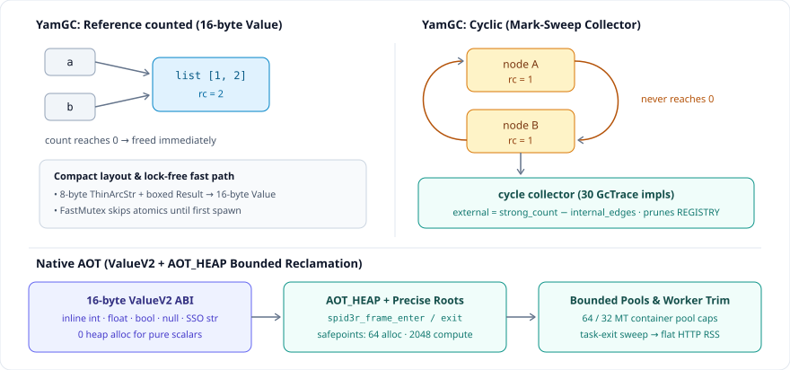
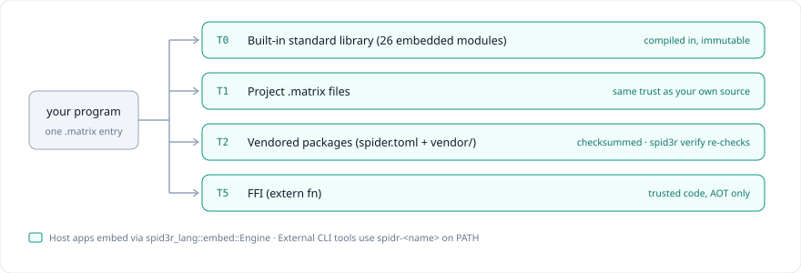
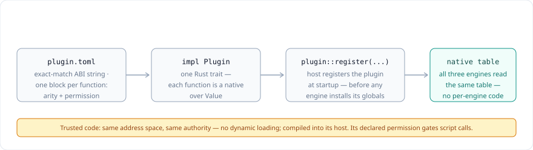
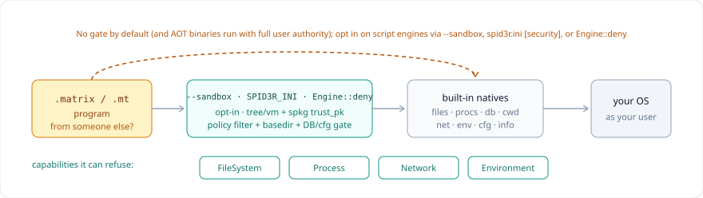
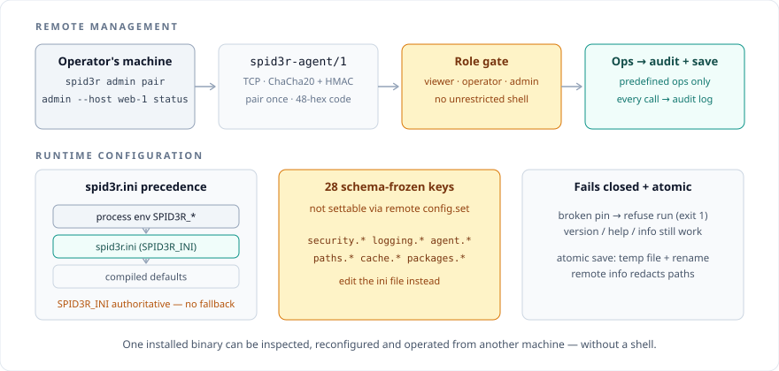
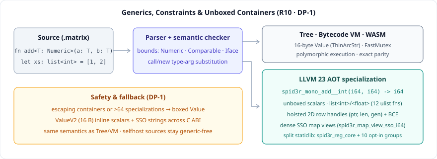
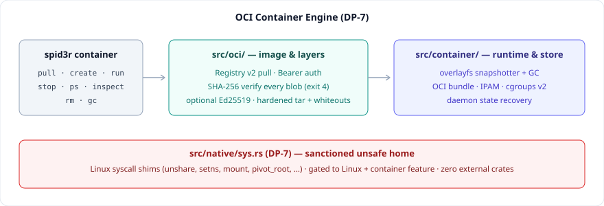
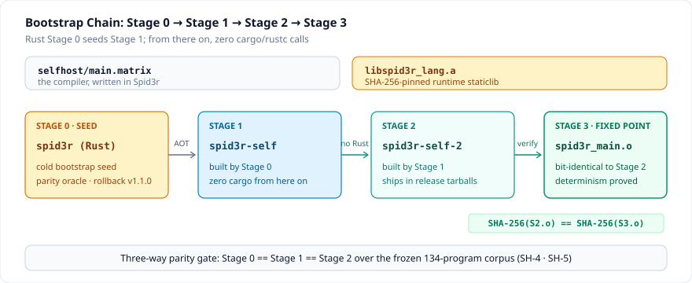
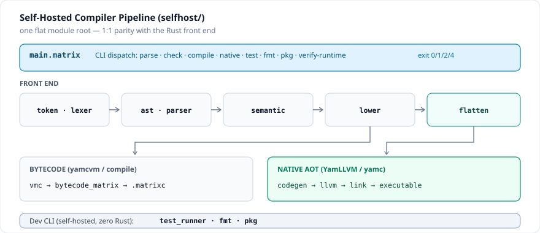
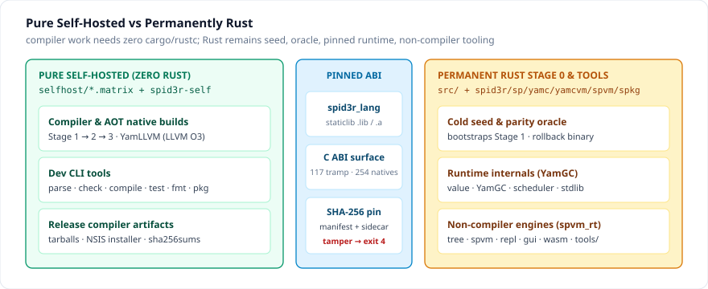

# Spid3r

**One front end. Four backends. Zero runtime dependencies.**

A programming language whose interpreters and compilers agree on stdout, error phase, and exit code.


```spid3r
fn main() {
    println("Hello, Spid3r!");
    return 0;
}
```

```bash
$ spid3r run hello.matrix
Hello, Spid3r!
```

## How it works

Source passes through one front end (`lexer` → `parser` → `semantic` → `lower`) into a checked AST consumed by four backends:

- **`tree`** — AST interpreter and reference oracle when engines disagree.
- **`vm`** — 60-opcode bytecode VM with peephole/loop-rotation optimizations (`--no-opt` disables them).
- **`native`** — LLVM 23 ahead-of-time machine code (built by Rust Stage 0 or self-hosted `spid3r-self`).
- **`wasm`** — the same bytecode VM compiled to `wasm32` for browsers.

`spid3r test` checks the three native engines together against identical **stdout**, **error phase**, and **exit code**.

## Memory



Values use deterministic reference counting for immediate drop cleanup, paired with a mark-and-sweep cycle collector (`gc_collect()`, `gc_live_cells()`).

## Ship it five ways


Releases bundle **`spid3r-self`** (self-hosted compiler & dev CLI), **`spid3r`** (interpreter, VM, REPL, LSP, debugger, agent, plugin host), and the SHA-256-pinned runtime archive (`spid3r-runtime-<ver>-<target>.tar.gz`):

- **Core CLI (`spid3r` VM / interpreter / REPL):** zero external runtime dependencies.
- **GUI (`spid3r gui`):** requires OS webview — WebView2 (Windows 10/11) or WebKit2GTK + GTK3 (Linux).
- **Native AOT (`spid3r build` / `spid3r-self`):** requires LLVM 23.1+; generated executables are standalone (static CRT on Windows).

## Ecosystem



| Route | Trust | Status |
|---|---|---|
| Embedded stdlib | immutable, compiled in | shipped |
| Project `.matrix` files | your own source | shipped |
| Spid3r plugins (`kind = "matrix"`) | written in Spid3r, script trust | shipped |
| Vendored packages | checksummed, verified by `spid3r verify` | shipped |
| WASM plugins | sandboxed (empty linker + fuel budget) | shipped |
| Host plugins | trusted Rust code, compiled in | shipped |
| FFI (`extern fn`) | trusted C ABI, AOT only | shipped |


- **Packages:** `spider.toml` + `src/`, vendored dependencies locked by `spider.lock` and verified by `spid3r verify` without running install scripts.
- **Registries & signing:** `spid3r install` resolves `path`, `git`, local, and `http(s)://` registries (`SPID3R_REGISTRY` / `packages.registry`) with semver unification, `sha256.txt`, and Ed25519 signature verification (`sha256.txt.sig` under `packages.trust_pk` / `SPID3R_TRUST_PK` / `registry.pub`) from `spid3r publish --to-dir`.

```bash
$ spid3r modules app.matrix --tree        # resolved import graph
$ spid3r verify                           # verify vendored tree vs spider.lock
```



- **Host plugins** (`plugin.toml` + Rust trait) compile into the host at startup with full address-space trust.
- **WASM plugins** (`plugin.toml` + `plugin.wasm`) load dynamically with zero host imports and a fuel limit (`spid3r build` rejects plugin calls cleanly at compile time).

```console
$ SPID3R_PLUGINS=examples/plugins spid3r run examples/plugins/hello-wasm/demo.matrix
Hello, Ada! (from wasm)
42
```

```rust
spid3r_lang::plugin::register(Box::new(HelloPlugin::new()))?;
```

Examples: [`hello-host`](examples/plugins/hello-host) · [`hello-wasm`](examples/plugins/hello-wasm)



- **Capability gate:** runs with user authority by default; `spid3r run --sandbox`, `spid3r exec --sandbox`, and Rust `Engine::deny` block filesystem, network, process, and env natives with catchable `sandboxed: ... denied` errors.



- **Runtime config:** `spid3r.ini` precedence layers, the encrypted `spid3r-agent/1` wire protocol, role-checked ops, and atomic saves — see [Runtime management](docs/AGENT.md).

## Generics & unboxing



- **Generics & unboxing (`R10`):** multi-arg type parameters (`<K, V>`, `<T: Numeric>`), explicit call/constructor instantiation (`identity<int>(x)`, `new Box<int>(v)`), erased `<T>` back-compat, AOT function monomorphization (`spid3r_mono_*`), and unboxed `list<int>` / `list<float>` storage ([Generics design](docs/GENERICS_DESIGN.md)).

## OCI containers



- **OCI containers (`R11`):** Registry v2 pull with SHA-256 verification, `.wh.` whiteout layer cache, copy-up / Linux `overlayfs` rootfs snapshotter, IPAM networking, and `--features container` Linux namespace shims ([OCI containers](docs/CONTAINERS.md)).

## Self-hosted compiler architecture







- **Self-hosted (`selfhost/`):** 17 compiler/CLI modules across 21 `.matrix` files build `spid3r-self` and drive `tokens`, `parse`, `check`, `compile`, `build`, `test`, `fmt`, `pack`/`unpack`/`verify`/`dist`, and `verify-runtime` with zero `cargo` calls.
- **Retained Rust Stage 0 (`src/`):** cold bootstrap seed, differential parity oracle, SHA-256-pinned runtime (`spid3r_lang`), and interactive/host tools (`tree`, `vm`, `repl`, `debug`, `lsp`, `doc`, `agent`, `gui`, `wasm32`, `plugin`).

See [docs/selfhost/](docs/selfhost/README.md) for ADRs, runtime ABI, and retirement boundary details.

## What's inside

| Aspect | Detail |
|---|---|
| **Implementation** | `102,312` lines of Rust (`src/`, zero dependencies in `--no-default-features`) + `17` self-hosted compiler & CLI modules (`selfhost/`, `21` `.matrix` files / `19,304` lines) |
| **Engines** | tree · bytecode VM · LLVM 23 AOT · WebAssembly |
| **Bytecode** | 60 opcodes · `.matrixc` container with SHA-256 integrity |
| **Standard library** | `29` `.matrix` modules + `257` built-in native entries (linked via `87` AOT C-ABI trampolines) |
| **Tests** | `1,394` Rust/integration tests (`1,367` core · `13` GUI · `14` native AOT) · 3-engine differential + `134`-program frozen selfhost corpus |
| **Self-hosting** | Stage 1 → Stage 2 → Stage 3 `spid3r_main.o` bit-identical fixed point & SHA-256 runtime pin ([docs/selfhost/](docs/selfhost/README.md)) |
| **Benchmarks** | Phase 11 compute reference (`VM`, `native`, `Node.js`, `Rust -O`) & Stage-0 vs selfhost throughput ([benchmark.html](docs/html/benchmark.html) · [selfhost baselines](benchmarks/selfhost/README.md)) |
| **Binary** | `spid3r` (`~12.4 MB`) + self-hosted `spid3r-self` (`~5.1 MB`) · static CRT on Windows · no installed runtime needed |

## The language

```spid3r
interface Greetable {
    public fn greet(self) -> string { return "Hi, " + self.name; }
}

class User implements Greetable {
    public let name: string;
    fn new(name: string) { self.name = name; }
    public static fn guest() { return new User("Guest"); }
}

fn main() {
    let u = User("Ada");
    let scores = { "math": 95, "cs": 100 };
    let doubled = [1, 2, 3].map(x => x * 2);
    println(u.greet() + " / cs=" + string(scores["cs"]) + " / " + string(doubled));
    return 0;
}
```

Optional types (`T?`, `int | string`) with flow-sensitive nullability narrowing (`if x != null`, `?`, `?.`), enum `match` exhaustiveness, classes with `static fn`, interfaces with defaults, selective imports, closures, `try`/`catch`, `spawn`/channels, 20+ containers, vectors/matrices, and `E1xxx` multi-error diagnostics.

## Install

```bash
# Linux / macOS
curl -fsSL https://raw.githubusercontent.com/needyamin/spid3r/main/install.sh | sh

# From source (core only, no LLVM)
cargo install --path . --no-default-features
```

**Windows:** run `Spid3r-Setup-<version>.exe` from the latest release (bundles `spid3r-self`, `spid3r`, `spid3r-control`, LLVM, and the SHA-256-pinned runtime).

## Toolchain

| Command | Does |
|---|---|
| `spid3r run app.matrix` | run on VM (`--engine tree` oracle, `--prof` opcode + function self-time) |
| `spid3r check` | types, scopes, flow narrowing, enum exhaustiveness, lints (`E1xxx`) |
| `spid3r repl` | interactive shell with TTY line editing & history (`read_line` non-TTY fallback) |
| `spid3r debug --break 12` | breakpoints, stepping, backtrace, locals |
| `spid3r fmt --check` | canonical formatting, exits 1 on drift |
| `spid3r doc [--json] [--private] [-o PATH]` | generate HTML or JSON documentation from doc comments |
| `spid3r test` | differential run across engines |
| `spid3r lsp` | editor server (diagnostics, hover, rename, code actions) |
| `spid3r build` | LLVM AOT native executable (`--freestanding`, `--target`, `--emit-obj`, `--enforce-budget`, `--allow-dlopen`) |
| `spid3r container` | OCI image pull/verify, rootfs snapshotter, and container lifecycle (`pull`, `create`, `run`, `ps`, `inspect`, `rm`, `gc`) |
| `spid3r bundle --target wasm` | offline web app |
| `spid3r init` · `install` · `dist` | projects, dependencies, release build |
| `spid3r add` · `remove` · `tree` · `verify` | declare, inspect, and checksum-verify dependencies |
| `spid3r modules` · `publish` · `search` | module origins and registry operations |
| `spid3r magic <cmd>` | run project-root `magic` framework CLI |
| `spid3r compile` · `gui` · `exec` · `bench` | `.matrixc` bytecode, windowed app, executor, benchmarks |
| `spid3r disasm app.matrixc` | bytecode disassembly (`exit 4` if corrupt) |
| `spid3r plugin` · `pack` · `unpack` · `verify-runtime` | plugin inspection, `tar+sha256` packages, runtime pin verify |
| `spid3r info` · `config` · `agent` · `admin` | build metadata, settings, remote management |

### Exit codes

| Code | Meaning |
|---|---|
| 0 | success |
| 1 | compile failure, runtime failure, or invalid config / broken `SPID3R_INI` pin |
| 2 | usage error (unknown command or invalid flags) |
| 4 | invalid bytecode (`.matrixc`) or corrupted/unpinned runtime archive |

- **Limits:** `--budget` / `--max-steps` caps work on tree/VM; `--max-call-depth` caps recursion (AOT enforces the 1,000-depth limit without step budgets).
- **Integrity:** `.matrixc` bytecode and `spid3r_lang` staticlibs verify SHA-256 digests on load (`exit 4` on mismatch).
- **Config pin (`SPID3R_INI`):** authoritative when non-empty; if missing or unreadable, execution commands exit `1` while `--version`, `help`, `info`, `config path`, and `config validate` stay usable for diagnosis.

## Documentation

| Guide | What's in it |
|---|---|
| [Developer guide](docs/html/doc.html) | 15-chapter tutorial, API reference, runnable samples |
| [Benchmarks](docs/html/benchmark.html) · [Selfhost baselines](benchmarks/selfhost/README.md) | VM/tree/PHP/Python tables, Phase 11 `P-1` & Stage-0 vs selfhost throughput |
| [Plugin guide](docs/html/plugin.html) · [ABI v1](docs/PLUGIN_ABI.md) | writing host/WASM plugins and ABI rules |
| [Playground](docs/html/playground.html) | run Spid3r in the browser |
| [Grammar](docs/GRAMMAR.md) | EBNF and precedence |
| [Standard library](docs/STANDARD_LIBRARY.md) | builtins and modules |
| [Ecosystem](docs/ECOSYSTEM.md) · [Registry](docs/REGISTRY.md) | packages, plugins, trust model, publishing |
| [Data structures](docs/DATA_STRUCTURES.md) | all 20+ containers |
| [Bytecode & VM](docs/BYTECODE.md) | `.matrixc` format, opcodes, scheduler |
| [Garbage collection](docs/GC.md) | cycle collector design |
| [Native backend](docs/NATIVE.md) · [Runtime ABI](docs/selfhost/RUNTIME_ABI.md) · [FFI](docs/FFI.md) | LLVM AOT · SHA-256 runtime contract · C FFI (`extern fn`) |
| [Generics design](docs/GENERICS_DESIGN.md) · [OCI containers](docs/CONTAINERS.md) | `DP-1` monomorphization/unboxing · OCI pull, whiteouts, `DP-7` container runtime |
| [GUI](docs/GUI.md) · [Embedding](docs/EMBEDDING.md) | desktop apps · Rust host embedding |
| [Environment](docs/ENVIRONMENT.md) | `SPID3R_*` environment variables |
| [Runtime management](docs/AGENT.md) | `spid3r.ini`, `spid3rinfo()`, encrypted remote agent |
| [Security policy](SECURITY.md) | trust model and reporting |
| [Audit status](docs/AUDIT_STATUS.md) | known issues and status |
| [Self-hosting docs & diagrams](docs/selfhost/README.md) · [ADR](docs/selfhost/SELFHOST.md) · [Retirement review](docs/selfhost/SELFHOST_RETIREMENT.md) | bootstrap stages, diagrams, corpus & ownership boundary |

## License

GNU General Public License, version 3 or later — see [LICENSE.md](LICENSE.md).

| Point | Meaning |
|---|---|
| **Use** | run, study, modify, and redistribute freely — commercial use included |
| **Share alike** | distribute a modified toolchain and source stays GPL |
| **No warranty** | provided as-is |

`spid3r build` statically links the GPL runtime into native executables; distribute `.matrixc` bytecode (`spid3r compile`) or add a runtime exception if permissive output is required.
