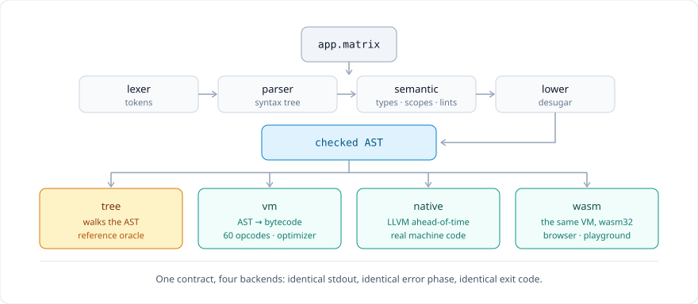
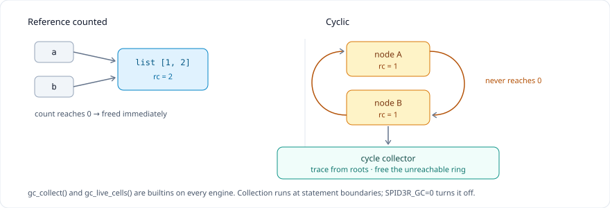
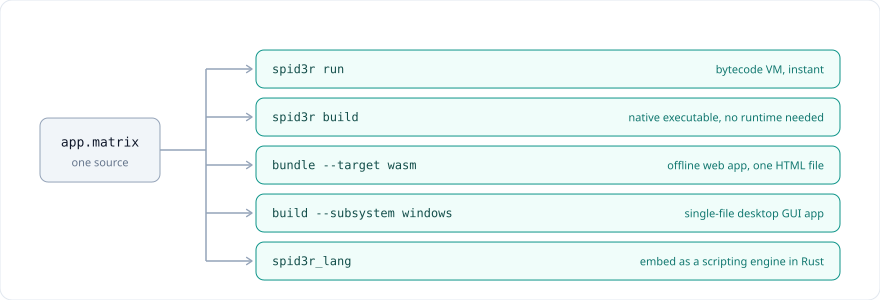
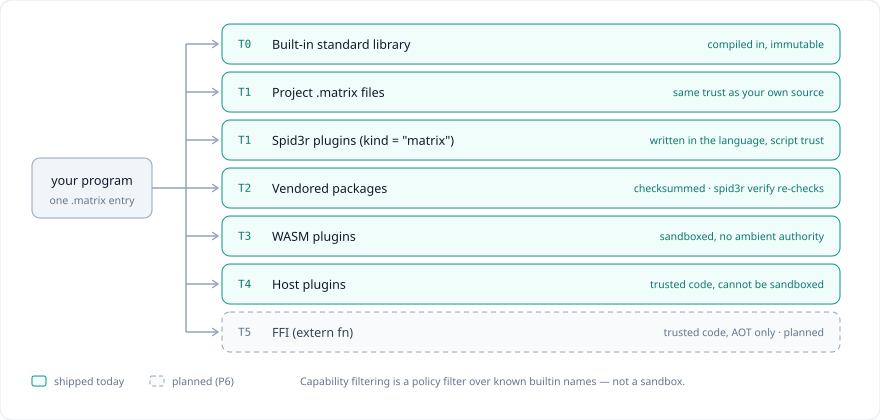
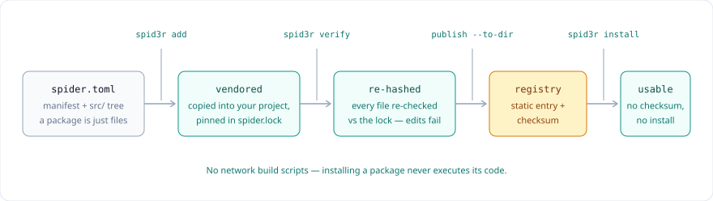
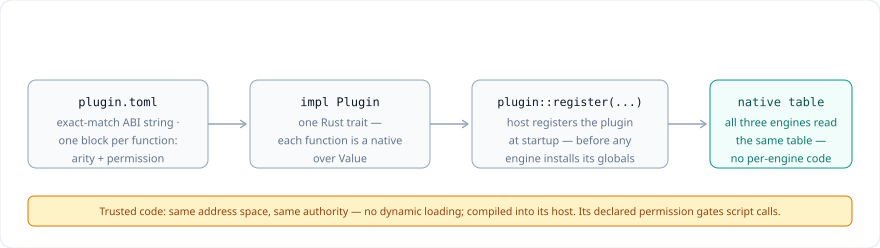
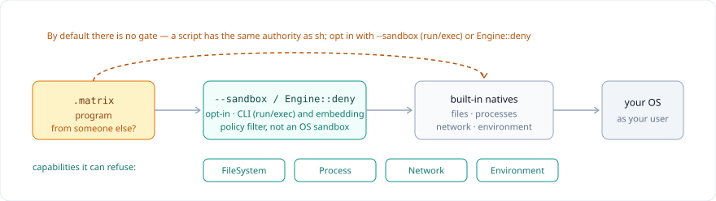

# Spid3r

**One front end. Four backends. Zero runtime dependencies.**

A programming language whose interpreters and compilers are required to agree with each other.



```spid3r
fn main() {
    println("Hello, Spid3r!");
    return 0;
}
```

```bash
$ spid3r run hello.matrix
Hello, Spid3r!
```

## How it works

Source goes through **one** front end — lexer, parser, semantic checker, lowering — and stops at a checked AST. Everything after that is a backend, and no backend may reinterpret the language.

- **The tree walker is the oracle.** When engines disagree, the plain AST interpreter defines what is correct.
- **The VM compiles to 60 opcodes** with a peephole optimizer. `--no-opt` exists so the optimizer can be tested against itself.
- **Native is real machine code** via LLVM — not a bundled interpreter wearing an `.exe`.
- **WebAssembly is the same VM**, compiled to wasm32.

Every backend must produce identical **stdout**, identical **error phase**, and identical **exit code**. `spid3r test` checks the three native engines on every run; CI holds the WebAssembly build to the same bar.

## Memory



Values are reference counted, so ordinary garbage dies the moment it is dropped. Cycles cannot, so a tracing mark-and-sweep collector reclaims them. `gc_collect()` and `gc_live_cells()` are builtins on every engine.

## Ship it five ways



The prebuilt release binaries are the **core toolchain only** (interpreter, VM, WASM) — no runtime dependencies, no dev tools required. Two backends have platform caveats when built from source:

- **GUI** needs the OS webview: WebView2 (preinstalled on Windows 10/11; the installer bundles its bootstrapper), or WebKit2GTK + GTK3 on Linux (install `libwebkit2gtk-4.1-dev` at build time and the `webkit2gtk` runtime package to run).
- **Native AOT** needs LLVM 18.1+ **at build time only**. Built executables are standalone — on Windows the toolchain delay-loads the bundled `LLVM-C.dll`; on Linux/macOS a source build with the `native` feature needs `libLLVM-18` present at runtime.

## Ecosystem



Third-party code reaches a program through seven routes, and only one of them can be sandboxed.



**Packages** ship today. A package is a `spider.toml` plus a `src/` tree; `spid3r add` declares and vendors it, `spid3r tree` shows what that resolved to, and `spid3r verify` re-hashes every vendored file against `spider.lock` so a hand-edited dependency fails instead of compiling. `spid3r publish --to-dir` writes a static registry entry with a checksum, and `spid3r install` **requires** that checksum for registry packages — a registry entry without one is refused rather than vendored unverified. No network build scripts — installing a package never executes its code.



**Host plugins work.** A plugin declares itself in a `plugin.toml` (exact-match ABI string, one block per function with its arity and permission), implements one trait, and is registered by its host at startup. Registration merges its functions into the native table all three engines already read, so a plugin function needs no per-engine code. There is no dynamic loading: a plugin is compiled into its host, because a native function is a Rust pointer over `Value` and `Value` has no stable C representation.

A *host* plugin is trusted code — same address space, same authority, and no capability filter can revoke that. Its declared permission is what lets a host stop a *script* from calling it.

**WASM plugins are the sandboxed route**, and they need no rebuild: `spid3r run` discovers `plugin.toml` + `plugin.wasm` on the plugin search path and interprets the module. The host links an empty linker, so a guest that imports anything — a file, a clock, a socket — fails to instantiate. Nothing is revoked at run time because nothing was ever granted, and a fuel budget means a `loop {}` traps instead of hanging.

```console
$ SPID3R_PLUGINS=examples/plugins spid3r run examples/plugins/hello-wasm/demo.matrix
Hello, Ada! (from wasm)
42
```

`spid3r build` refuses a program that calls a plugin function: a standalone native executable cannot link one, and that is a compile-time error rather than a binary that throws at run time.

```rust
spid3r_lang::plugin::register(Box::new(HelloPlugin::new()))?;
```

Both samples are in the repository: [`hello-host`](examples/plugins/hello-host) (compiled in) and [`hello-wasm`](examples/plugins/hello-wasm) (sandboxed).

| Route | Trust | Status |
|---|---|---|
| Embedded stdlib | immutable, compiled in | shipped |
| Project `.matrix` files | your own source | shipped |
| Spid3r plugins (`kind = "matrix"`) | written in the language, script trust | shipped |
| Vendored packages | checksummed, re-checked by `spid3r verify` | shipped |
| WASM plugins | sandboxed, loaded from disk | shipped |
| Host plugins | trusted code, not sandboxable | shipped |
| FFI (`extern fn`) | trusted code, AOT only | shipped |

```bash
$ spid3r modules src/main.matrix --tree   # which file does each import name?
$ spid3r verify                           # is the vendored tree the one the lock describes?
```



By default a program runs with the full authority of the user who started it. `spid3r run --sandbox` and `spid3r exec --sandbox` opt into a capability gate — filesystem, network, process and environment access are refused with catchable `sandboxed: ... denied` errors, enforced through the single native funnel every engine installs from, so an imported module cannot re-arm what was denied. When embedding in Rust, `Engine::deny` applies the same policy. It is a policy filter over built-in natives, not an OS-level sandbox.

## What's inside

| Aspect | Detail |
|---|---|
| **Implementation** | 88,054 lines of Rust · zero dependencies in the core (`--no-default-features`) |
| **Engines** | tree · bytecode VM · LLVM AOT · WebAssembly |
| **Bytecode** | 60 opcodes · serialized `.matrixc` format |
| **Standard library** | 29 modules, compiled into the binary |
| **Tests** | 1,210 tests · three-engine differential |
| **Binary** | one ~13 MB file · static CRT · runs with no installed runtime |

## The language

```spid3r
interface Greetable {
    public fn greet(self) -> string { return "Hi, " + self.name; }
}

class User implements Greetable {
    public let name: string;
    fn new(name: string) { self.name = name; }
    public static fn guest() { return new User("Guest"); }
}

fn main() {
    let u = User("Ada");
    let scores = { "math": 95, "cs": 100 };
    let doubled = [1, 2, 3].map(x => x * 2);
    println(u.greet() + " / cs=" + string(scores["cs"]) + " / " + string(doubled));
    return 0;
}
```

Types are optional (including nullable `T?` and union `int | string` annotations). Classes with `static fn` methods, interfaces with default method bodies, selective cross-module imports (`import { A, B as C } from "mod"`), arrow closures (`x => expr`), map literals (`{ "k": v }`), raw strings (`r"..."`), `try`/`catch`, `spawn` and channels, 20+ native containers, vectors and matrices — all in the core.

## Install

```bash
# Linux / macOS
curl -fsSL https://raw.githubusercontent.com/needyamin/spid3r/main/install.sh | sh

# From source: core only, no LLVM and no system libraries
cargo install --path . --no-default-features
```

**Windows:** run `Spid3r-Setup-<version>.exe` from the latest release.

## Toolchain

| Command | Does |
|---|---|
| `spid3r run app.matrix` | execute on the VM (`--engine tree` for the oracle) |
| `spid3r check` | types, scopes, lints — no execution |
| `spid3r repl` | interactive shell |
| `spid3r debug --break 12` | breakpoints, stepping, backtrace, locals |
| `spid3r fmt --check` | canonical formatting, exits 1 on drift |
| `spid3r test` | differential run across engines |
| `spid3r lsp` | editor server: diagnostics, hover, rename, actions |
| `spid3r build` | native executable |
| `spid3r bundle --target wasm` | offline web app |
| `spid3r init` · `install` · `dist` | projects, dependencies, release build |
| `spid3r add` · `remove` · `tree` · `verify` | declare, inspect and check dependencies |
| `spid3r modules` · `publish` · `search` | module origins, registry entries |
| `spid3r magic <cmd>` | run project-root `magic` framework CLI from any subdirectory |
| `spid3r compile` · `gui` · `exec` · `bench` | bytecode file, windowed app, script runner, benchmarks |
| `spid3r disasm app.matrixc` | human-readable bytecode disassembly (exit 4 on a corrupt file) |
| `spid3r plugin` · `pack` · `unpack` | plugin inspection, tar+sha256 archive, extract |
| `spid3r info` · `config` · `agent` · `admin` | build info, settings, management agent |

### Exit codes

| Code | Meaning |
|---|---|
| 0 | success |
| 1 | program error (compile failure or runtime failure) |
| 2 | usage error (unknown command or bad arguments) |
| 4 | invalid bytecode (corrupt or malformed `.matrixc`) |

`spid3r run --budget` (alias `--max-steps`) caps the work untrusted code may do; `--max-call-depth` caps recursion and applies to the tree and VM engines — the native AOT backend enforces neither. `spid3r run --sandbox` and `spid3r exec --sandbox` deny file-system, network, process and environment access to the program (catchable `sandboxed: ... denied` errors). `.matrixc` files written by `spid3r compile` carry a SHA-256 integrity checksum, verified on load: a corrupt or modified file exits 4 with `bytecode integrity check failed`. That checksum is an integrity check (bit rot, corruption, lazy tampering), **not** an authenticity control — anyone can recompute it; signing distributed bytecode (e.g. with the in-tree Ed25519 implementation) is a noted future direction. AOT-produced executables report runtime failures with their own process conventions and are not bound by this table.

## Documentation

| Guide | What's in it |
|---|---|
| [Developer guide](docs/html/doc.html) | 15-chapter tutorial, API reference, runnable samples |
| [Spid3rWeb guide](docs/html/spid3rweb.html) | web framework: routing, ORM, SpiderBD views, auth, `magic` CLI |
| [Plugin guide](docs/html/plugin.html) · [ABI v1](docs/PLUGIN_ABI.md) | how to write a plugin · the contract, and what forces a v2 |
| [Playground](docs/html/playground.html) | run Spid3r in the browser |
| [Grammar](docs/GRAMMAR.md) | EBNF and precedence |
| [Standard library](docs/STANDARD_LIBRARY.md) | every builtin and module |
| [Ecosystem](docs/ECOSYSTEM.md) · [Registry](docs/REGISTRY.md) | packages, plugins, trust model · publishing |
| [Data structures](docs/DATA_STRUCTURES.md) | all 20+ containers |
| [Bytecode & VM](docs/BYTECODE.md) | `.matrixc` format, opcodes, scheduler |
| [Garbage collection](docs/GC.md) | cycle collector design |
| [Native backend](docs/NATIVE.md) · [FFI](docs/FFI.md) | LLVM AOT · calling C with `extern fn` |
| [GUI](docs/GUI.md) · [Embedding](docs/EMBEDDING.md) | desktop apps · Rust host |
| [Environment](docs/ENVIRONMENT.md) | every `SPID3R_*` knob |
| [Runtime management](docs/AGENT.md) | `spid3r.ini`, `spid3rinfo()`, the encrypted remote agent |
| [Security policy](SECURITY.md) | trust model, reporting, known gaps |
| [Audit status](docs/AUDIT_STATUS.md) | known issues and their state |

## License

Spid3r is free software under the **GNU General Public License, version 3 or later**. The full text is in [LICENSE.md](LICENSE.md).

| Point | Meaning |
|---|---|
| **Use** | run, study, modify and redistribute freely — commercial use included |
| **Share alike** | distribute a modified toolchain and the source must stay available under the GPL |
| **No warranty** | provided as-is, without warranty of any kind |

One consequence worth knowing before you ship: `spid3r build` statically links the GPL runtime library into the executable it produces, so binaries you distribute that way carry GPL obligations. If you need permissively licensed output, add a runtime exception to your build or distribute bytecode via `spid3r compile` instead.
