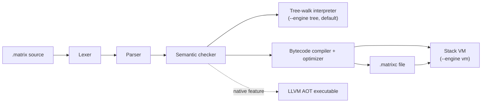

# Spid3r

**A small, dynamically typed programming language with optional static types, written in pure Rust.**

Spid3r programs (`.matrix` files) run on two interchangeable engines — a tree-walking
reference interpreter and a bytecode compiler with a stack VM — that are tested to produce
identical output. The core toolchain has **zero third-party dependencies**.

```text
fn main() {
    println("Hello, Spid3r!");
    return 0;
}
```

```sh
$ spid3r run hello.matrix
Hello, Spid3r!
```

---

## Contents

- [Features](#features)
- [Getting started](#getting-started)
- [Language tour](#language-tour)
- [Quick reference: data structures & stdlib](#quick-reference-data-structures--stdlib)
- [Execution model](#execution-model)
- [Command-line reference](#command-line-reference)
- [Projects and dependencies](#projects-and-dependencies)
- [Backends](#backends)
- [Embedding from Rust](#embedding-from-rust)
- [Developer workflow & testing](#developer-workflow--testing)
- [Repository layout](#repository-layout)
- [Documentation](#documentation)
- [Known limitations](#known-limitations)
- [License](#license)

## Features

- **Readable syntax**: `fn`, `let`, `const`, `if`/`elif`/`else`, `while`, `for … in`, C-style `for`.
- **First-class functions and closures** that capture their surrounding variables (both top-level and local `fn` declarations).
- **Classes and interfaces**: single inheritance (`extends`), `implements`, and
  `public`/`private` members (private by default, enforced at check time).
- **Structured errors**: `throw`, `try`/`catch`/`finally` (running `finally` deterministically on normal exit, throw, `return`, `break`, and `continue`), plus `option` (`some`/`none`)
  and `result` (`ok`/`err`) values for expected failures.
- **Gradual typing**: optional annotations (`a: int`, `-> string`), checked before the program runs.
- **20+ built-in data structures**: `list`, `vec`, `tuple`, `map`, `set`, `bag`, `hash_table`, `stack`, `queue`, `deque`, `ring_buffer`, `heap`, `priority_queue`, `binary_tree`, `bst`, `trie`, `graph`, `matrix`, `vector`, `bytes`, linked lists, and more — all covered by automatic cycle garbage collection.
- **Scientific computing & Linear algebra**: Contiguous 1D `vector` and 2D `matrix` types with BLAS-style operations (dot product, norm, cross product, matrix multiplication, axis reductions), elementwise math, and NumPy `.npy` v1.0 binary serialization (`save_npy`, `load_npy`).
- **Binary I/O, CSV, Regex & DateTime**: Native raw `bytes` type with hex/base64 encoding, RFC-4180 CSV parser/writer with type inference, zero-dependency Thompson NFA regex engine, and civil calendar date/time math.
- **Concurrency**: `spawn` tasks on a threaded scheduler, `async`/`await`, `channel`, `mutex`, `ref`.
- **Networking & Web Servers**: TCP sockets, HTTP/1.1 framing, client `http_fetch`, and a pure-Spid3r web framework (`stdlib/http.matrix`) with zero external dependencies.
- **Modules** with explicit `public` exports, and a package manager with lockfiles and POSIX `ustar` archiving.
- **Tooling**: formatter, REPL, line debugger, benchmark runner, and differential tester.
- **Backends & Packaging**: WebAssembly in-browser execution, cross-platform bundler (`spid3r bundle` for WASM, Desktop, and Android), desktop webview GUI, and an LLVM ahead-of-time compiler for native executables.
- **Embeddable from Rust**: host applications register Rust closures as script functions, bind globals, and run scripts with captured output through the zero-dependency `spid3r::embed` API.

## Getting started

### Install

**Linux / macOS** — one-line installer (curl or wget, POSIX `sh`):

```sh
curl -fsSL https://raw.githubusercontent.com/needyamin/spid3r/main/install.sh | sh
```

The script detects your architecture, downloads the matching release tarball from GitHub,
installs `spid3r` into `~/.spid3r/bin`, and adds that directory to your `PATH` in
`~/.bashrc`, `~/.zshrc`, and `~/.profile`. Options:

```sh
sh install.sh --version 1.0.0   # pin a release instead of latest
sh install.sh --dir ~/.local/bin
sh install.sh --source          # build from source via cargo (no release needed)
```

**Windows** — run the NSIS installer `Spid3r-Setup-<version>.exe` from a release, or build
from source as shown below.

### Build from source

You can build the core language toolchain with **zero external dependencies** using `--no-default-features`, or build with the default GUI and LLVM native backends (requires LLVM 18.1+ for `native`):

```sh
# Zero-dependency core toolchain (fastest build, no LLVM required)
cargo build --release --no-default-features

# Core + desktop webview GUI (no LLVM required)
cargo build --release --no-default-features --features gui

# Full default build: Core + GUI + LLVM AOT native backend
cargo build --release
```

On Windows, `cargo build --release` also writes the installer `Spid3r-Setup-<version>.exe` to
the repository root when NSIS is available in `packaging/nsis/nsis/nsis-3.10/` or `PATH` (skipped
with a warning when NSIS is missing). Set `SPID3R_NO_INSTALLER=1` to skip installer generation.

### Run your first program

```sh
spid3r run examples/hello.matrix              # tree-walking interpreter (default)
spid3r run --engine vm examples/hello.matrix  # bytecode VM
spid3r check examples/hello.matrix            # static type, arity, and privacy check
spid3r repl                                   # interactive prompt
```

Every executable program defines `fn main()`. If `main` returns an integer, that integer
becomes the process exit code. Files without `main` are library modules that can be imported.

## Language tour

All snippets below run unchanged on both engines. The output is shown in comments.

### Variables, functions, and collections

```text
const LIMIT = 3;

fn add(a: int, b: int) -> int {            // type annotations are optional
    return a + b;
}

fn make_counter() {
    let count = 0;
    return fn() {                          // closure captures `count`
        count += 1;
        return count;
    };
}

fn main() {
    let xs = list(1, 2, 3, 4, 5);
    println(xs.filter(fn(x) { return x % 2 == 0; }));        // [2, 4]
    println(xs.reduce(0, fn(acc, x) { return acc + x; }));   // 15

    let tick = make_counter();
    tick();
    println(tick());                                         // 2

    for i in [1, 2, 3] {
        if i == LIMIT { break; }
        println("i={}".format(i));                           // i=1, i=2
    }

    let ports = map("http", 80, "https", 443);
    ports["ssh"] = 22;
    println(ports.keys());                                   // [http, https, ssh]
    println(add(2, 3));                                      // 5
    return 0;
}
```

### Classes and interfaces

```text
interface Shape {
    fn area(self) -> float;
}

class Rect implements Shape {
    public let w;
    public let h;

    fn new(w, h) {                 // constructor, called via `new Rect(...)`
        self.w = w;
        self.h = h;
    }

    public fn area(self) -> float {
        return float(self.w * self.h);
    }
}

class Square extends Rect {
    fn new(side) {
        self.w = side;
        self.h = side;
    }
}

fn main() {
    for s in [new Rect(2, 3), new Square(4)] {
        println(s.area());         // 6.0, then 16.0
    }
    return 0;
}
```

### Error handling

```text
fn parse_age(s) {
    let n = int(s);
    if n < 0 {
        return err("age cannot be negative");
    }
    return ok(n);
}

fn main() {
    try {
        println(10 / 0);
    } catch (e) {
        println("caught: " + e);                  // caught: division by zero
    } finally {
        println("cleanup");                       // always runs (even on return/break/continue)
    }

    let r = parse_age("-1");
    if r.is_err() {
        println(r.unwrap_err());                  // age cannot be negative
    }
    println(parse_age("42").unwrap_or(0));        // 42
    return 0;
}
```

If an error is never caught, the program prints its source position and a stack trace,
then exits with code `1`. File and process builtins (`read_file`, `write_file`,
`spawn_process`) return `result` values instead of throwing.

### Concurrency

```text
async fn sum(a, b) {
    return await a + await b;                     // `await` is only valid inside `async fn`
}

fn main() {
    let t1 = spawn fn() { return 20; };
    let t2 = spawn fn() { return 22; };
    println(sum(t1, t2));                         // 42

    let ch = channel();
    spawn fn() { ch.send("ping"); };
    println(ch.recv());                           // ping
    return 0;
}
```

Tasks also expose `status()`, `join()`, and `is_done()`. A failed task re-raises its
error when joined.

### Modules

```text
// math_util.matrix — a library: no main, only `public` names are exported
public fn square(x) { return x * x; }
fn helper() { return 42; }                        // private to this file

// modules.matrix
import "math_util";

fn main() {
    println(square(5));                           // 25
    return 0;
}
```

Imports are resolved next to the importing file first, then on `SPID3R_PATH`, then in
`./stdlib`, and finally in the project's `vendor/` directory.

### Semantics at a glance

| Topic | Behavior |
|---|---|
| Primitive types | `int` (64-bit), `float` (64-bit), `bool`, `string` (immutable UTF-8), `null` |
| Arithmetic | `int + float` gives a `float`; `7 / 2` is `3`; integer overflow wraps; dividing by zero throws |
| Equality | `1 == 1.0` is `true` |
| Logic | `and`, `or`, `not` (short-circuit); there is no `!`, `++`, or `**` (use `pow`) |
| Truthiness | `null`, `false`, `0`, `0.0`, `""`, and `none` are falsy |
| Comments | `// line` and `/* block */` |

For the complete grammar, see [`docs/GRAMMAR.md`](docs/GRAMMAR.md).

## Quick reference: data structures & stdlib

### Built-in data structures

| Category | Constructors | Key methods |
|---|---|---|
| **Sequences** | `[a, b]` / `list(…)`, `vec(…)`, `tuple(…)`, `deque()`, `ring_buffer(cap)`, `linked_list()`, `singly_linked_list()`, `doubly_linked_list()` | `push`, `pop`, `peek`, `get`, `set`, `insert`, `remove`, `slice`, `sort`, `reverse`, `map`, `filter`, `reduce`, `for_each`, `all`, `any` |
| **Binary & buffers** | `bytes(size\|list\|str)` | `len`, `get`, `set`, `slice`, `to_list`, `to_string`, `to_hex`, `from_hex`, `to_base64`, `from_base64`, `copy` |
| **Numeric & linear algebra** | `vector(n[, fill])` / `vector(list)`, `matrix(rows, cols[, fill])` / `matrix_from_list(rows, cols, list)` | `dot`, `norm`, `normalize`, `outer`, `cross`, `to_list`, `to_matrix`, `reshape`, `sum`, `mean`, `save_npy`, `row`, `col`, `add`, `mul` |
| **Stacks, queues & heaps** | `stack(…)`, `queue()`, `heap("min"\|"max")`, `priority_queue(["min"\|"max"])` | `push`, `pop`, `peek`, `len`, `is_empty`, `to_list` |
| **Associative** | `map(k, v, …)`, `set(…)`, `bag()`, `hash_table()` | `m[k]`, `m[k] = v`, `get`, `set`, `remove`, `has`, `keys`, `values`, `items`, `union`, `intersection`, `difference`, `count_of` |
| **Trees & graphs** | `binary_tree()`, `bst()`, `trie()`, `graph("directed"\|"undirected")` | `insert`, `contains`, `inorder`, `bfs`, `dfs`, `add_node`, `add_edge`, `find_path` |
| **Concurrency & refs** | `channel()`, `mutex(v)`, `ref(v)`, `weak(v)` | `send`, `recv`, `try_recv`, `lock`, `unlock`, `get`, `set`, `deref(w)` |

> **Vectors & linear algebra.** `vector(n, fill)` creates a contiguous 1D array of 64-bit floats.
> Supports vector-vector operations (`v1.dot(v2)`, `v.norm()`, `v.normalize()`, `v1.outer(v2)`,
> `v1.cross(v2)` for 3D), vector-matrix multiplication (`v * m` and `m * v`), elementwise math
> (`v + v`, `v * scalar`), indexing (`v[i]`), slicing, and `.save_npy(path)` binary export.
> See [`docs/DATA_STRUCTURES.md`](docs/DATA_STRUCTURES.md).

> **Binary `bytes` type.** `bytes(size)` allocates a zero-initialized buffer; `bytes("hello")`
> or `bytes([0xde, 0xad])` converts from text or numeric lists. Supports `b[i]` indexing
> (integers `0..255`), `.to_hex()` / `bytes.from_hex(s)`, `.to_base64()` / `bytes.from_base64(s)`,
> `.slice(s, e)`, and native binary file I/O via `read_bytes(path)` and `write_bytes(path, b)`.

> **Grid indexing.** A `matrix` is one flat row-major buffer of floats:
> `m[i]` reads (or assigns) cell `i` counted from the top-left and answers
> with a `float`, *not* a row — so `m[i][j]` is invalid. Use `m.get(r, c)` /
> `m.set(r, c, v)` for two-dimensional addressing, `m.row(r)` / `m.col(c)`
> for whole rows and columns, `m.sum([axis])` / `m.mean([axis])`, `m.save_npy(path)`,
> and `len(m)` for the cell count (`rows * cols`). See [`docs/DATA_STRUCTURES.md`](docs/DATA_STRUCTURES.md).

> **Sorting with a comparator.** `xs.sort_by(cmp)` sorts in place and
> `xs.sorted_by(cmp)` returns a new list; `xs.argsort()` returns the original
> indices in ascending order. `cmp(a, b)` may return a bool (`true` means `a`
> comes first) or a number (negative / zero / positive). Sorts are stable, and
> a comparator that throws, mutates the receiver, or touches a self-referential
> list gets a clean error or a deterministic result — never a deadlock.

> **Float precision in `format`.** `"{:.2}".format(88.6875)` renders `"88.69"`;
> `N` runs 0–15. `{}` is unchanged, and rounding is tie-to-even (so
> `"{:.0}".format(2.5)` is `"2"`, unlike `round(2.5)`).

### Global standard library functions

| Category | Functions |
|---|---|
| **Console & I/O** | `print(…)`, `println(…)`, `eprint(…)`, `read_line()`, `exec_capture(cmd, args[, stdin])` |
| **Files & binary I/O** | `read_file(path)`, `write_file(path, text)`, `read_bytes(path)`, `write_bytes(path, b)`, `load_npy(path)`, `file_exists(path)`, `env(name)`, `args()`, `spawn_process(cmd, args)` |
| **Structured data (CSV & JSON)** | `read_csv(path[, delim])`, `parse_csv(str[, delim])`, `write_csv(path, rows[, delim])`, `json_parse(s)`, `json_write(v)` |
| **Regular expressions** | `regex_match(pat, text)`, `regex_find(pat, text)`, `regex_find_all(pat, text)`, `regex_replace(pat, text, repl)` |
| **Date & time** | `unix_time()`, `unix_ms()`, `datetime_parts(ts)`, `datetime_from_parts(map)`, `format_datetime(ts, fmt)` |
| **Networking & HTTP** | `tcp_listen(addr)`, `tcp_accept(id)`, `tcp_connect(addr)`, `tcp_read(id, n)`, `tcp_write(id, s)`, `tcp_close(h)`, `tcp_local_addr(h)`, `tcp_peer_addr(id)`, `tcp_set_timeout(id, ms)`, `http_read_request(id)`, `http_write_response(id, st, h, b)`, `http_fetch(m, u[, h, b])`, `url_decode(s)`, `url_encode(s)` |
| **Math & random** | `abs(x)`, `sqrt(x)`, `pow(b, e)`, `min(a, b, …)`, `max(a, b, …)`, `clamp(x, lo, hi)`, `floor(x)`, `ceil(x)`, `round(x)`, `trunc(x)`, `sign(x)`, `exp(x)`, `ln(x)`, `log10(x)`, `log2(x)`, `sin(x)`, `cos(x)`, `tan(x)`, `asin(x)`, `acos(x)`, `atan(x)`, `atan2(y, x)`, `hypot(x, y)`, `is_nan(x)`, `is_inf(x)`, `float_or(s, default)`, `nan()`, `inf()`, `random_int(lo, hi)`, `random_float()`, `random_normal()` |
| **Crypto** | `sha256(s)`, `hmac_sha256(key, msg)` — lowercase hex digests |
| **Types & conversion** | `int(x)`, `float(x)`, `string(x)`, `bool(x)`, `type_of(x)`, `len(x)` |
| **Option & result** | `some(v)`, `none`, `ok(v)`, `err(e)` |
| **Testing & assertions** | `assert(cond[, msg])`, `assert_eq(a, b[, msg])` |
| **Time, tasks & GC** | `now()`, `sleep_ms(n)`, `yield()`, `task_count()`, `gc_collect()`, `gc_live_cells()` |

`exec_capture(cmd, args, stdin_text)` spawns a process with piped stdin,
stdout and stderr, writes `stdin_text` (`null` closes stdin at once), and
returns `ok(map("code", exit, "stdout", …, "stderr", …))` or `err(msg)` when
the process cannot be spawned or writes non-UTF-8 output. Each pipe is capped
at 64 MiB.

### First-party standard library modules (`./stdlib/`)

Spid3r ships with four production-grade, zero-dependency first-party standard libraries located in `./stdlib/`. These are automatically discovered by the module resolver and support both flat and namespaced imports (`import "name" as alias;`):

| Module | Focus & Features | Key APIs |
|---|---|---|
| **`stdlib/web.matrix`** | **Express / PHP Alternative**<br/>Router, middlewares, parameter extraction, forms, templates, cookies, JWT auth | `web_app()`, `app.get/post/put/delete`, `parse_query(qs)`, `parse_form(b)`, `json_response(st, d)`, `html_response(st, h)`, `escape_html(s)`, `render_template(t, ctx)`, `parse_cookies(req)`, `set_cookie(res, k, v, opts)`, `jwt_sign(payload, secret)`, `jwt_verify(token, secret)` |
| **`stdlib/dataframe.matrix`** | **Pandas Alternative**<br/>Columnar table backed by native `vector` (numeric) and `list` (categorical) | `from_records(recs)`, `from_csv(path)`, `to_csv(df, path)`, `select(cols)`, `filter(pred)`, `sort_by(col, desc)`, `group_by(key, aggs)`, `inner_join(df2, on)`, `drop_na(col)`, `fill_na(col, val)`, `head(n)`, `describe()`, `print_table()` |
| **`stdlib/stats.matrix`** | **SciPy Stats Alternative**<br/>Statistical reductions, distributions, correlation, hypothesis testing | `mean(x)`, `median(x)`, `mode(x)`, `variance(x, ddof)`, `std(x, ddof)`, `percentile(x, p)`, `quantile(x, q)`, `iqr(x)`, `covariance(x, y)`, `pearson(x, y)`, `spearman(x, y)`, `zscore(x)`, `normal_pdf(x, mu, s)`, `normal_cdf(x, mu, s)`, `t_test_ind(a, b)`, `chi_square(obs, exp)`, `train_test_split(X, y, ratio, seed)` |
| **`stdlib/ml.matrix`** | **Scikit-Learn Alternative**<br/>Regression, classification, clustering, PCA decomposition, evaluation metrics | `linear_regression_fit(X, y)` & `predict`, `logistic_regression_fit(X, y, lr, epochs)` & `predict`, `knn_predict(X_tr, y_tr, X_te, k)`, `kmeans_fit(X, k, iters)`, `pca_fit_transform(X, n_comps)`, `accuracy`, `precision`, `recall`, `f1_score`, `confusion_matrix`, `mse`, `rmse`, `r2_score` |

See [`docs/STANDARD_LIBRARY.md`](docs/STANDARD_LIBRARY.md) for full module API signatures and examples.

## Execution model



1. **Front end.** Lexing, parsing, and semantic checking are shared by every engine. The
   checker catches unknown names, private-member access, arity errors, and type-annotation
   mismatches before any code runs.
2. **Tree-walk interpreter.** The reference implementation, and the default engine for `run`.
3. **Bytecode VM.** Compiles the checked syntax tree to bytecode, then optimizes it with
   constant folding, peephole rewrites, and dead-code elimination (`--no-opt` disables the
   optimizer). Both engines share one value and runtime layer, which is what keeps their
   output identical.
4. **`.matrixc` files.** `spid3r compile` writes self-contained bytecode with every
   imported module embedded, so `spid3r exec` needs no source files. Bytecode is validated
   before execution: malformed input becomes a clean error, never a crash.

**Memory.** Values are reference-counted and thread-safe, so they can cross `spawn`
boundaries. A trial-deletion cycle collector runs automatically at statement boundaries and
reclaims reference cycles across **all 20+ built-in containers and class instances**
(`list`, `vec`, `stack`, `queue`, `deque`, `linked_list`, `set`, `map`, `hash_table`, `bag`,
`ring_buffer`, `binary_tree`, `bst`, `heap`, `priority_queue`, `graph`, `trie`, `matrix`,
`ref`, `option`/`result` wrappers, and instances). Set `SPID3R_GC=0` to disable automatic
collection, call `gc_collect()` / `gc_live_cells()` to control or inspect the collector, or
use `weak(v)` and `deref(w)` for explicit non-owning references. See [`docs/GC.md`](docs/GC.md).

## Command-line reference

| Command | Description |
|---|---|
| `spid3r run [--engine tree\|vm] [--no-opt] <file> [args…]` | Check and run a program; extra arguments are available through `args()` |
| `spid3r check <file>` | Lex, parse, and semantic-check without running |
| `spid3r compile <file> [-o out] [--dump] [--no-opt]` | Write bytecode (`.matrixc`); `--dump` prints the disassembly |
| `spid3r exec <file.matrixc>` | Run compiled bytecode on the VM |
| `spid3r repl` | Interactive prompt (`:help`, `:reset`, `:quit`) |
| `spid3r fmt [--check] [files…]` | Format files in place; `--check` exits `1` if any file would change |
| `spid3r debug <file> [--break L,…] [--commands FILE]` | Line debugger: breakpoints, step/next/finish, backtrace, locals |
| `spid3r test` | Run every `examples/*.matrix` on the tree interpreter, the VM, and compile + exec, and compare their output |
| `spid3r bench [--engine tree\|vm] [--runs N] [--compare] [files…]` | Time `benchmarks/*.matrix`, keeping the best of N runs |
| `spid3r init [dir]` | Create `spider.toml` and `src/main.matrix` |
| `spid3r install` | Vendor dependencies into `vendor/` and write `spider.lock` |
| `spid3r dist [-o out] [--no-opt]` | Compile the project entry to `target/<package>.matrixc` |
| `spid3r pack [-o out.tar]` / `spid3r unpack <archive> [dir]` | Archive a project into a POSIX `ustar` tarball (with long-filename & checksum support), or extract one |
| `spid3r build <file> [-o out] [--target triple] [--release]` | Build a native executable (`native` feature) |
| `spid3r gui <file> [--html page.html] [--dry-run]` | Run a program in a webview window (`gui` feature) |
| `spid3r bundle <file> [--target wasm\|desktop\|android] [--html page.html] [-o out] [--single-file]` | Package into a standalone distribution (WebAssembly, Desktop, or Android) |
| `spid3r version` / `spid3r help` | Print version or usage |

**Exit codes:** `0` means success, `1` means a program error, and `2` means a usage error.
A program's own exit code comes from the integer returned by `main`.

## Projects and dependencies

```sh
spid3r init myproj && cd myproj
spid3r run            # with no file argument, runs the manifest's entry
```

```toml
# spider.toml
[package]
name = "myproj"
version = "0.1.0"
entry = "src/main.matrix"

[dependencies]
mathlib = { path = "../mathlib" }                            # local path
extras  = { git = "https://example/extras", rev = "main" }   # git, pinned to a commit
serde   = { version = "^1.0" }                               # offline registry ($SPID3R_REGISTRY)
```

- `spid3r install` copies dependency sources into `vendor/` and writes a deterministic
  `spider.lock`, with a SHA-256 hash for each dependency.
- `[workspace] members = [...]` lets several packages share one `vendor/` and one lockfile.
- `spid3r pack` and `spid3r unpack` produce and verify deterministic POSIX `ustar` tarballs
  (supporting long paths via the 155-byte `ustar` prefix and GNU `@LongLink` headers, with
  header checksum validation and path-traversal protection).
- Inside a project, `spid3r test` runs `tests/*.matrix` on both engines. Write tests with
  `assert` and `assert_eq`.

There is no remote package registry. Dependencies of registry packages are not resolved
transitively. See [`docs/REGISTRY.md`](docs/REGISTRY.md).

## Backends

Both backends are on by default, and the Windows installer ships both.

```sh
cargo build --release                                        # core + GUI + LLVM compiler (needs LLVM 18.1+)
cargo build --release --no-default-features --features gui   # core + GUI, no LLVM needed
cargo build --release --no-default-features                  # core toolchain only, zero dependencies
```

- **Native (`spid3r build`).** Compiles a program to a standalone machine-code executable.
  Runtime operations reuse the VM's value code, so the output matches the interpreters.
  `spid3r.exe` loads `LLVM-C.dll`, and linking a program needs MSVC Build Tools with the
  Windows SDK; the built executables have no LLVM dependency. See
  [`docs/NATIVE.md`](docs/NATIVE.md) and [`docs/BUILDING.md`](docs/BUILDING.md).
- **GUI (`spid3r gui`).** Programs call `gui_set_html`, `gui_eval`, `gui_on`, `gui_emit`,
  and `gui_title`, and the page calls `window.spid3r.emit(event, payload)`. With
  `--dry-run`, the bridge runs without a window. See [`docs/GUI.md`](docs/GUI.md) and
  `examples/gui/counter.matrix`.
- **WebAssembly & Browser ([`docs/html/playground.html`](docs/html/playground.html)).** Compiles the full language toolchain to
  `wasm32-unknown-unknown` with zero external dependencies. Programs can be evaluated, type-checked,
  and canonically formatted in web browsers, Node.js, and edge workers via [`web/spid3r.js`](web/spid3r.js)
  and [`web/spid3r.wasm`](web/spid3r.wasm). Try it live in [`docs/html/playground.html`](docs/html/playground.html).
  - **Zero-Setup Offline Execution**: Double-clicking `docs/html/playground.html` opens cleanly on local `file:///` URLs
    using the companion in-memory dataset ([`web/spid3r_wasm_data.js`](web/spid3r_wasm_data.js)), bypassing browser CORS restrictions.
  - **Rich Features**: Share snippets via URL hash (`#code=...`), import/export `.matrix` files, drag-and-drop,
    and toggle between Bytecode VM and Tree-walk interpreter.
- **Application Bundler (`spid3r bundle`).** Package any Spid3r application into standalone distributions:
  - `--target wasm --single-file`: Completely offline, zero-dependency HTML file containing embedded base64 WebAssembly runtime and program bytecode.
  - `--target wasm`: Web distribution directory (`index.html`, `spid3r.js`, `spid3r.wasm`, `app.matrix`).
  - `--target desktop`: Precompiled `.matrixc` bytecode with native launcher scripts (`run.bat` and `run.sh`).
  - `--target android`: Ready-to-build Android Studio WebView application project scaffold.

## Embedding from Rust

Spid3r's core is a zero-dependency Rust library, so a Rust application can host it as a
scripting layer through `spid3r::embed`:

```rust
use spid3r::embed::{conv, Engine};

let engine = Engine::new()
    .register("shout", |args| {
        let s = conv::as_str(args.first().unwrap_or(&spid3r::Value::Null)).unwrap_or("");
        Ok(conv::from_string(s.to_uppercase()))
    })
    .set_global("version", conv::from_string("1.0"));

let out = engine
    .run("demo", r#"fn main() { println(shout("hi") + " " + version); return 0; }"#)
    .expect("script failed");
assert_eq!(out.output, "HI 1.0\n");
```

- **Host functions** are stateful Rust closures; an `Err(String)` return becomes a catchable
  Spid3r runtime error, and host functions work as collection callbacks (`xs.map(host_fn)`).
- **Host globals** are dynamic values; `add_module_dir` extends the import search path.
- **Runs** execute on a dedicated big-stack worker and capture `print`/`println`/`eprint` output;
  `main`'s integer return is the exit code.

A runnable demo ships as `cargo run --example embed_hello`. Full API reference:
[`docs/EMBEDDING.md`](docs/EMBEDDING.md).

## Developer workflow & testing

Correctness in Spid3r means *the engines agree*. All **447 Rust tests** (**418** core tests including WASM & Bundler suites + **29** GUI/AOT-headless tests) and **25/25 differential example programs** can be run locally without LLVM:

```sh
# 1. Run all 418 core unit, integration, networking, wasm, bundler, regression, and fuzz tests
cargo test --no-default-features

# 2. Run the 10 headless GUI bridge tests
cargo test --no-default-features --features gui --test gui_tests

# 3. Build the WebAssembly release binary
cargo build --target wasm32-unknown-unknown --release --lib --no-default-features

# 4. Run 3-way differential testing across all examples (tree vs VM vs .matrixc)
cargo run --no-default-features -- test

# 5. Verify canonical formatting and zero Clippy warnings (matches CI)
cargo run --no-default-features -- fmt --check
cargo clippy --no-default-features --all-targets -- -D warnings
```

- `tests/audit_regressions.rs` pins engine parity across closures, loop bindings, `finally`
  on early exits, cycle-safe containers, task errors, and stdlib edge cases — including the
  math, crypto, `exec_capture`, and scientific-notation regressions added in the 2026-10
  standard-library expansion.
- `tests/fuzz_tests.rs` and `fuzz/` test lexer, parser, semantic checker, formatter, and
  bytecode verifier resilience against arbitrary and mutated inputs.
- `spid3r bench --compare` benchmarks `benchmarks/*.matrix` while asserting identical output
  between the tree interpreter and the VM.
- Audit findings and verification notes are documented in [`docs/AUDIT_REPORT.md`](docs/AUDIT_REPORT.md).

## Repository layout

| Path | Description |
|---|---|
| `src/lexer`, `src/parser`, `src/ast` | Tokenizer, Pratt parser (with recursion cap), and AST definitions |
| `src/semantic` | Name resolution, arity, privacy, `main` validation, and gradual type checker |
| `src/interpreter`, `src/environment` | Reference tree-walking interpreter and lexical scopes |
| `src/vm` | Bytecode compiler, peephole/constant-folding optimizer, `.matrixc` serializer, validator, stack VM, and line debugger |
| `src/value` | Shared value representation, 20+ built-in collections (`src/value/collections/`), and full-container trial-deletion cycle GC (`src/value/gc.rs`) |
| `src/sched`, `src/stdlib`, `src/modules` | Threaded task scheduler, channels/mutexes, global builtins, and module loader |
| `src/wasm.rs`, `web/`, `docs/html/playground.html` | WebAssembly zero-dependency C-ABI runtime, browser JS SDK, and live interactive playground |
| `src/pkg`, `src/fmt.rs`, `src/repl`, `src/cli.rs` | Package manager (`spider.toml`, `ustar` archiver), canonical formatter, REPL, and CLI |
| `src/native`, `src/gui` | Optional LLVM 18.1+ AOT backend (`native`) and desktop webview bridge (`gui`) |
| `src/embed.rs`, `examples_rust/` | Embedding API for Rust hosts (`spid3r::embed::Engine`) and the runnable demo |
| `examples/`, `benchmarks/`, `stdlib/` | 23 runnable example programs/libraries, 8 benchmarks, and standard library modules |
| `demo_apps/` | Native GUI Calculator (`demo_apps/native_calculator/`) and Web Calculator (`demo_apps/web_calculator/`) |
| `tests/`, `fuzz/`, `tools/` | Integration, differential, cycle-GC, packaging, audit-regression, wasm, and fuzz suites, plus `tools/difftest.sh` |
| `docs/`, `doc.html` | Deep-dive technical documentation and self-contained interactive developer guide |

## Documentation

| Document | Contents |
|---|---|
| [Interactive developer guide (`doc.html`)](https://needyamin.github.io/spid3r/doc.html) | Self-contained single-page reference with search, dark mode, cheat sheet, and examples |
| [WebAssembly Playground (`playground.html`)](docs/html/playground.html) | Live in-browser code editor, syntax checker, formatter, and dual VM/Tree runner |
| [Benchmarks Report (`benchmarks.html`)](docs/html/benchmarks.html) | Performance comparisons across Spid3r VM, Python 3, and PHP 8 |
| [Web Calculator Demo (`demo_apps/web_calculator`)](demo_apps/web_calculator/index.html) | Interactive browser calculator powered by `engine.matrix` |
| [Native Calculator Demo (`demo_apps/native_calculator`)](demo_apps/native_calculator/README.md) | Flagship native Windows GUI calculator app |
| [`docs/GRAMMAR.md`](docs/GRAMMAR.md) | EBNF grammar and precedence rules |
| [`docs/KEYWORDS.md`](docs/KEYWORDS.md) | Reserved words |
| [`docs/STANDARD_LIBRARY.md`](docs/STANDARD_LIBRARY.md) | Global functions |
| [`docs/DATA_STRUCTURES.md`](docs/DATA_STRUCTURES.md) | Built-in containers and their methods |
| [`docs/BYTECODE.md`](docs/BYTECODE.md) | `.matrixc` format and VM design |
| [`docs/GC.md`](docs/GC.md) | Cycle collector |
| [`docs/NATIVE.md`](docs/NATIVE.md) · [`docs/BUILDING.md`](docs/BUILDING.md) | LLVM backend and build setup |
| [`docs/GUI.md`](docs/GUI.md) | Webview GUI layer |
| [`docs/REGISTRY.md`](docs/REGISTRY.md) | Local dependency registry |
| [`docs/EMBEDDING.md`](docs/EMBEDDING.md) | Embedding API for Rust hosts |
| [`docs/ROADMAP.md`](docs/ROADMAP.md) | Roadmap and limitations |
| [`docs/AUDIT_REPORT.md`](docs/AUDIT_REPORT.md) | Codebase audit report and regression summary |

Runnable examples live in [`examples/`](examples/). Run any of them with
`spid3r run examples/<name>.matrix`.

## Known limitations

- `-9223372036854775808` cannot be written as a direct integer literal before unary negation.
- The native backend rejects classes declared inside a function.
- Dependencies are local only: path, git, or an offline registry directory.

## License

MIT, as declared in [`Cargo.toml`](Cargo.toml).
