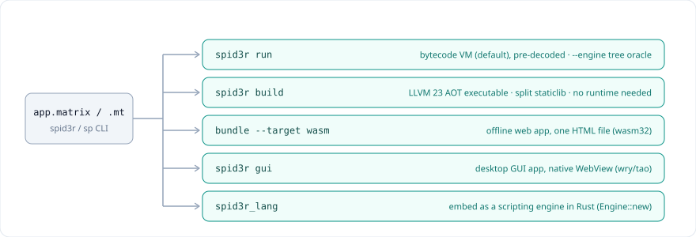

# Spid3r

**One front end. Four backends. Zero runtime dependencies.**

A programming language whose interpreters and compilers agree on stdout, error phase, and exit code.


```js
fn main() {
    println("Hello, Spid3r!");
    return 0;
}
```

```bash
$ spid3r run hello.matrix
  Hello, Spid3r!

$ sp run hello.mt
  Hello, Spid3r!
```

Both `.matrix` and `.mt` source extensions and the CLI binaries (`spid3r`, short alias `sp`, plus additive component CLIs `yamc`, `yamcvm`, `spvm`, `spkg`) execute in-process with zero runtime overhead.

## How it works

Source passes through one front end (`lexer` → `parser` → `semantic` → `lower`) into a checked AST consumed by four **Spid3r Engine** backends:

- **`tree`** — AST interpreter and reference oracle when engines disagree (`spvm_rt`).
- **`vm`** — 60-opcode bytecode VM (**`spvm`** / **`spvm_rt`**) compiled by **`yamcvm`** (`spid3r compile` → `.matrixc`) with peephole/loop-rotation optimizations (`--no-opt` disables them).
- **`native`** — **YamLLVM** (LLVM 23 ahead-of-time machine code via `yamc` / `spid3r build` or self-hosted `spid3r-self`).
- **`wasm`** — the same bytecode VM compiled to `wasm32` for browsers.

`spid3r test` checks the three native engines together against identical **stdout**, **error phase**, and **exit code**.

## Memory (YamGC)


**YamGC** pairs deterministic reference counting for immediate drop cleanup with a mark-and-sweep cycle collector (`gc_collect()`, `gc_live_cells()`) and bounded `ValueV2`/`AOT_HEAP` frame-root reclamation in native builds.

## Ship it five ways



Releases bundle **`spid3r-self`** (self-hosted compiler & dev CLI), **`spid3r`** (interpreter, VM, REPL, LSP, debugger, GUI), and the SHA-256-pinned runtime archive (`spid3r-runtime-<ver>-<target>.tar.gz`):

- **Core CLI (`spid3r` VM / interpreter / REPL):** zero external runtime dependencies.
- **GUI (`spid3r gui`):** requires OS webview — WebView2 (Windows 10/11) or WebKit2GTK + GTK3 (Linux).
- **Native AOT (`spid3r build` / `spid3r-self`):** requires LLVM 23.1+; generated executables are standalone (static CRT on Windows).

## Ecosystem


| Route | Trust | Status |
|---|---|---|
| Embedded stdlib | immutable, compiled in (`26` modules, `254` natives) | shipped |
| Project `.matrix` / `.mt` files | your own source | shipped |
| Vendored packages &amp; binary wheels | Ed25519 + SHA-256 lock (`spkg verify` / `audit` / `--frozen`) | shipped |
| FFI (`extern fn`) | trusted C ABI + verified vendored `[ffi]` auto-linking, AOT only | shipped |


## Self-hosted compiler architecture


- **Self-hosted (`selfhost/`):** 17 compiler/CLI modules across 21 `.matrix` files build `spid3r-self` and drive `tokens`, `parse`, `check`, `compile`, `build`, `test`, `fmt`, `pack`/`unpack`/`verify`/`dist`, and `verify-runtime` with zero `cargo` calls.
- **Retained Rust Stage 0 (`src/`):** cold bootstrap seed, differential parity oracle, SHA-256-pinned runtime (`spid3r_lang`), and interactive/host tools (`tree`, `vm`, `repl`, `debug`, `lsp`, `doc`, `gui`, `wasm32`).

See [docs/selfhost/](docs/selfhost/README.md) for ADRs, runtime ABI, and retirement boundary details.

## The language

```js
interface Greetable {
    public fn greet(self) -> string { return "Hi, " + self.name; }
}

class User implements Greetable {
    public let name: string;
    fn new(name: string) { self.name = name; }
    public static fn guest() { return new User("Guest"); }
}

fn main() {
    let u = User("Ada");
    let scores = { "math": 95, "cs": 100 };
    let doubled = [1, 2, 3].map(x => x * 2);
    println(u.greet() + " / cs=" + string(scores["cs"]) + " / " + string(doubled));
    return 0;
}
```

Optional types (`T?`, `int | string`) with flow-sensitive nullability narrowing (`if x != null`, `?`, `?.`), enum `match` exhaustiveness, classes with `static fn`, interfaces with defaults, selective imports, closures, `try`/`catch`, `spawn`/channels, 20+ containers, vectors/matrices, and `E1xxx` multi-error diagnostics.

## Install

```bash
# Linux / macOS
curl -fsSL https://raw.githubusercontent.com/needyamin/spid3r/main/install.sh | sh

# From source (core only, no LLVM)
cargo install --path . --no-default-features
```

**Windows:** run `Spid3r-Setup-<version>.exe` from the latest release (bundles `spid3r-self`, `spid3r`, `sp`, `yamc`, `yamcvm`, `spvm`, `spkg`, `spid3r-control`, LLVM, `.matrix`/`.mt` associations, and the SHA-256-pinned `spid3r_lang` runtime).

## Toolchain

All commands below work identically with `spid3r` or the short alias `sp`, and accept both `.matrix` and `.mt` source files. Focused zero-overhead component CLIs are also installed alongside them:

- **`yamc`** — native AOT compiler (**YamLLVM** backend): `yamc app.mt -o app --release` (or `yamc build|check|compile|verify-runtime ...`)
- **`yamcvm`** — bytecode compiler (emits SHA-256 `.matrixc`): `yamcvm app.mt -o app.matrixc` (or `yamcvm compile|disasm|check|dist ...`)
- **`spvm`** — virtual machine (**`spvm_rt`**): `spvm app.matrixc`, `spvm app.mt`, `spvm exec|run|disasm|repl|debug ...`
- **`spkg`** — enterprise package manager (`spider.toml`): `spkg init|add|remove|install|list|show|outdated|audit|freeze|tree|verify|search|publish|pack|unpack|cache|tool|dist ...`

| Command | Does |
|---|---|
| `spid3r run app.matrix` | run on VM (`--engine tree` oracle, `--prof` opcode + function self-time) |
| `spid3r check` | types, scopes, flow narrowing, enum exhaustiveness, lints (`E1xxx`) |
| `spid3r repl` | interactive shell with TTY line editing & history (`read_line` non-TTY fallback) |
| `spid3r debug --break 12` | breakpoints, stepping, backtrace, locals |
| `spid3r fmt --check` | canonical formatting, exits 1 on drift |
| `spid3r doc [--json] [--private] [-o PATH]` | generate HTML or JSON documentation from doc comments |
| `spid3r test` | differential run across engines |
| `spid3r lsp` | editor server (diagnostics, hover, rename, code actions) |
| `spid3r build` | LLVM AOT native executable with verified `[ffi]` auto-linking (`--no-auto-ffi`, `--freestanding`, `--target`, `--emit-obj`, `--enforce-budget`, `--allow-dlopen`) |
| `spid3r bundle --target wasm` | offline web app |
| `spid3r init` · `install` · `dist` | projects, dependencies (`--frozen`, `--offline`, `--dev`, `--extra`), release build |
| `spid3r add` · `remove` · `tree` · `verify` | declare, inspect, and SHA-256 verify vendored source + `_native/` wheels |
| `spid3r list` · `show` · `outdated` · `audit` · `freeze` | inspect deps, check yanks/advisories/signatures, export pins or CycloneDX SBOM (`--sbom`) |
| `spid3r cache` · `tool` · `modules` · `publish` · `search` | shared cache, isolated `[bin]` CLI tool shims, module origins, signed registries (`--target`) |
| `spid3r magic <cmd>` | run project-root `magic` framework CLI |
| `spid3r compile` · `gui` · `exec` · `bench` | `.matrixc` bytecode, windowed app, executor, benchmarks |
| `spid3r disasm app.matrixc` | bytecode disassembly (`exit 4` if corrupt) |
| `spid3r pack` · `unpack` · `verify-runtime` | `tar+sha256` packages, runtime pin verify |
| `spid3r info` · `neofetch` · `config` · `control` | build metadata, system banner, `spid3r.ini` settings, local control surface |

### Exit codes

| Code | Meaning |
|---|---|
| 0 | success |
| 1 | compile failure, runtime failure, or invalid config / broken `SPID3R_INI` pin |
| 2 | usage error (unknown command, invalid flags, or missing input file) |
| 4 | invalid bytecode (`.matrixc`) or corrupted/unpinned runtime archive |

- **Limits:** `--budget` / `--max-steps` caps work on tree/VM; `--max-call-depth` caps recursion (AOT enforces the 1,000-depth limit without step budgets).
- **Integrity:** `.matrixc` bytecode and `spid3r_lang` staticlibs verify SHA-256 digests on load (`exit 4` on mismatch).
- **Config pin (`SPID3R_INI`):** authoritative when non-empty; if missing or unreadable, execution commands exit `1` while `--version`, `help`, `info`, `neofetch`, `config path`, and `config validate` stay usable for diagnosis.

## Documentation

| Guide | What's in it |
|---|---|
| [Developer guide](docs/html/doc.html) · [Packages (`spkg`)](docs/html/package.html) | 15-chapter tutorial, API reference, enterprise package guide |
| [Benchmarks](docs/html/benchmark.html) · [Selfhost baselines](benchmarks/selfhost/README.md) | VM/tree/PHP/Python tables, Phase 11 `P-1` & Stage-0 vs selfhost throughput |
| [Playground](docs/html/playground.html) | run Spid3r in the browser |
| [Grammar](docs/GRAMMAR.md) | EBNF and precedence |
| [Standard library](docs/STANDARD_LIBRARY.md) | builtins and modules |
| [Ecosystem](docs/ECOSYSTEM.md) · [Registry](docs/REGISTRY.md) | packages, trust model, publishing |
| [Data structures](docs/DATA_STRUCTURES.md) | all 20+ containers |
| [Bytecode & VM](docs/BYTECODE.md) | `.matrixc` format, opcodes, scheduler |
| [Garbage collection](docs/GC.md) | cycle collector design |
| [Native backend](docs/NATIVE.md) · [Runtime ABI](docs/selfhost/RUNTIME_ABI.md) · [FFI](docs/FFI.md) | LLVM AOT · SHA-256 runtime contract · C FFI (`extern fn`) |
| [Generics design](docs/GENERICS_DESIGN.md) | `DP-1` monomorphization and unboxed containers |
| [GUI](docs/GUI.md) · [Embedding](docs/EMBEDDING.md) | desktop apps · Rust host embedding |
| [Environment](docs/ENVIRONMENT.md) | `SPID3R_*` environment variables |
| [Security policy](SECURITY.md) | trust model and reporting |
| [Audit status](docs/AUDIT_STATUS.md) | known issues and status |
| [Self-hosting docs & diagrams](docs/selfhost/README.md) · [ADR](docs/selfhost/SELFHOST.md) · [Retirement review](docs/selfhost/SELFHOST_RETIREMENT.md) | bootstrap stages, diagrams, corpus & ownership boundary |

## License

GNU General Public License, version 3 or later (with the **Spid3r Runtime Library Exception** under GPLv3 Section 7) — see [LICENSE.md](LICENSE.md).

| Point | Meaning |
|---|---|
| **Use** | run, study, modify, and redistribute freely — commercial use included |
| **Share alike** | distribute a modified toolchain or runtime (`spid3r_lang`) and its source stays GPL |
| **User programs** | compiled `.matrixc`, native executables (`spid3r build` / `spid3r-self`), and `bundle` outputs can use any license of your choice under the GPLv3 Section 7 exception |
| **No warranty** | provided as-is |
