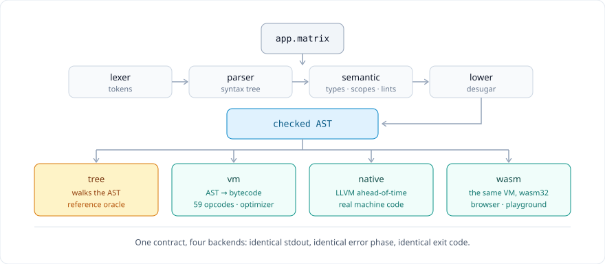
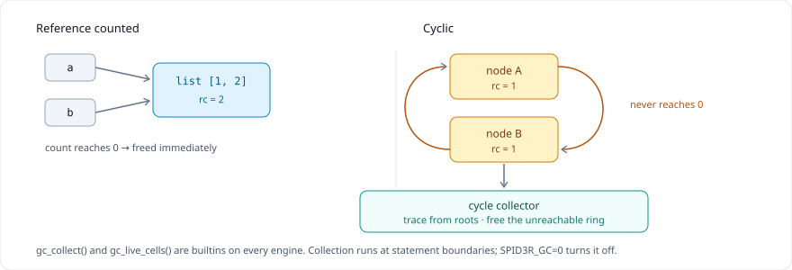
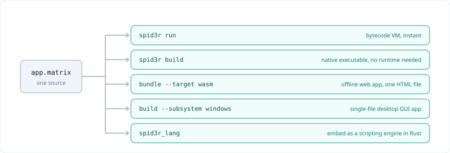
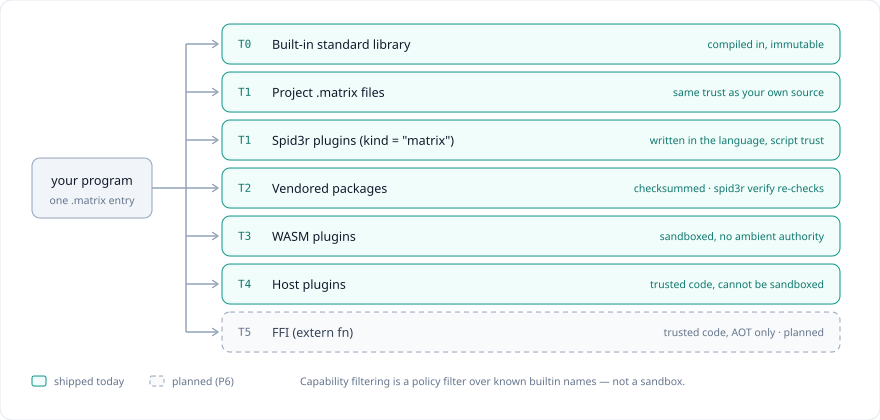

# Spid3r

**One front end. Four backends. Zero runtime dependencies.**

A programming language whose interpreters and compilers are required to agree with each other.



```spid3r
fn main() {
    println("Hello, Spid3r!");
    return 0;
}
```

```bash
$ spid3r run hello.matrix
Hello, Spid3r!
```

## How it works

Source goes through **one** front end — lexer, parser, semantic checker, lowering — and stops at a checked AST. Everything after that is a backend, and no backend may reinterpret the language.

- **The tree walker is the oracle.** When engines disagree, the plain AST interpreter defines what is correct.
- **The VM compiles to 59 opcodes** with a peephole optimizer. `--no-opt` exists so the optimizer can be tested against itself.
- **Native is real machine code** via LLVM — not a bundled interpreter wearing an `.exe`.
- **WebAssembly is the same VM**, compiled to wasm32.

Every backend must produce identical **stdout**, identical **error phase**, and identical **exit code**. `spid3r test` checks the three native engines on every run; CI holds the WebAssembly build to the same bar.

## Memory



Values are reference counted, so ordinary garbage dies the moment it is dropped. Cycles cannot, so a tracing mark-and-sweep collector reclaims them. `gc_collect()` and `gc_live_cells()` are builtins on every engine.

## Ship it five ways



## Ecosystem



Third-party code reaches a program through seven routes, and only one of them can be sandboxed.

**Packages** ship today. A package is a `spider.toml` plus a `src/` tree; `spidr add` declares and vendors it, `spidr tree` shows what that resolved to, and `spidr verify` re-hashes every vendored file against `spider.lock` so a hand-edited dependency fails instead of compiling. `spidr publish --to-dir` writes a static registry entry with a checksum. No network, no build scripts — installing a package never executes its code.

**Host plugins work.** A plugin declares itself in a `plugin.toml` (exact-match ABI string, one block per function with its arity and permission), implements one trait, and is registered by its host at startup. Registration merges its functions into the native table all three engines already read, so a plugin function needs no per-engine code. There is no dynamic loading: a plugin is compiled into its host, because a native function is a Rust pointer over `Value` and `Value` has no stable C representation.

A *host* plugin is trusted code — same address space, same authority, and no capability filter can revoke that. Its declared permission is what lets a host stop a *script* from calling it.

**WASM plugins are the sandboxed route**, and they need no rebuild: `spidr run` discovers `plugin.toml` + `plugin.wasm` on the plugin search path and interprets the module. The host links an empty linker, so a guest that imports anything — a file, a clock, a socket — fails to instantiate. Nothing is revoked at run time because nothing was ever granted, and a fuel budget means a `loop {}` traps instead of hanging.

```console
$ SPID3R_PLUGINS=examples/plugins spidr run examples/plugins/hello-wasm/demo.matrix
Hello, Ada! (from wasm)
42
```

`spidr build` refuses a program that calls a plugin function: a standalone native executable cannot link one, and that is a compile-time error rather than a binary that throws at run time.

```rust
spid3r_lang::plugin::register(Box::new(HelloPlugin::new()))?;
```

Both samples are in the repository: [`hello-host`](examples/plugins/hello-host) (compiled in) and [`hello-wasm`](examples/plugins/hello-wasm) (sandboxed).

| Route | Trust | Status |
|---|---|---|
| Embedded stdlib | immutable, compiled in | shipped |
| Project `.matrix` files | your own source | shipped |
| Spid3r plugins (`kind = "matrix"`) | written in the language, script trust | shipped |
| Vendored packages | checksummed, re-checked by `spidr verify` | shipped |
| WASM plugins | sandboxed, loaded from disk | shipped |
| Host plugins | trusted code, not sandboxable | shipped |
| FFI (`extern fn`) | trusted code, AOT only | shipped |

```bash
$ spid3r modules src/main.matrix --tree   # which file does each import name?
$ spid3r verify                           # is the vendored tree the one the lock describes?
```

## What's inside

| Aspect | Detail |
|---|---|
| **Implementation** | 80,115 lines of Rust · zero dependencies in the core (`--no-default-features`) |
| **Engines** | tree · bytecode VM · LLVM AOT · WebAssembly |
| **Bytecode** | 59 opcodes · serialized `.matrixc` format |
| **Standard library** | 29 modules, compiled into the binary |
| **Tests** | 1,083 tests · three-engine differential |
| **Binary** | one 11 MB file · static CRT · runs with no installed runtime |

## The language

```spid3r
fn add(a: int, b: int) -> int { return a + b; }

class User {
    public let name;
    fn new(name) { self.name = name; }
    public fn greet(self) -> string { return "Hi, " + self.name; }
}

fn main() {
    let u = User("Ada");
    println(u.greet() + " / 2 + 3 = " + string(add(2, 3)));
    return 0;
}
```

Types are optional. Classes, interfaces, closures, `try`/`catch`, `spawn` and channels, 20+ native containers, vectors and matrices — all in the core.

## Install

```bash
# Linux / macOS
curl -fsSL https://raw.githubusercontent.com/needyamin/spid3r/main/install.sh | sh

# From source: core only, no LLVM and no system libraries
cargo install --path . --no-default-features
```

**Windows:** run `Spid3r-Setup-<version>.exe` from the latest release.

## Toolchain

| Command | Does |
|---|---|
| `spid3r run app.matrix` | execute on the VM (`--engine tree` for the oracle) |
| `spid3r check` | types, scopes, lints — no execution |
| `spid3r repl` | interactive shell |
| `spid3r debug --break 12` | breakpoints, stepping, backtrace, locals |
| `spid3r fmt --check` | canonical formatting, exits 1 on drift |
| `spid3r test` | differential run across engines |
| `spid3r lsp` | editor server: diagnostics, hover, rename, actions |
| `spid3r build` | native executable |
| `spid3r bundle --target wasm` | offline web app |
| `spid3r init` · `install` · `dist` | projects, dependencies, release build |
| `spid3r add` · `remove` · `tree` · `verify` | declare, inspect and check dependencies |
| `spid3r modules` · `publish` · `search` | module origins, registry entries |

## Documentation

| Guide | What's in it |
|---|---|
| [Developer guide](docs/html/doc.html) | 15-chapter tutorial, API reference, runnable samples |
| [Plugin guide](docs/html/plugin.html) | how to write a plugin, and how it works |
| [Playground](docs/html/playground.html) | run Spid3r in the browser |
| [Grammar](docs/GRAMMAR.md) | EBNF and precedence |
| [Standard library](docs/STANDARD_LIBRARY.md) | every builtin and module |
| [Ecosystem](docs/ECOSYSTEM.md) · [Registry](docs/REGISTRY.md) | packages, plugins, trust model · publishing |
| [Data structures](docs/DATA_STRUCTURES.md) | all 20+ containers |
| [Bytecode & VM](docs/BYTECODE.md) | `.matrixc` format, opcodes, scheduler |
| [Garbage collection](docs/GC.md) | cycle collector design |
| [Native backend](docs/NATIVE.md) · [FFI](docs/FFI.md) | LLVM AOT · calling C with `extern fn` |
| [GUI](docs/GUI.md) · [Embedding](docs/EMBEDDING.md) | desktop apps · Rust host |
| [Environment](docs/ENVIRONMENT.md) | every `SPID3R_*` knob |
| [Security policy](SECURITY.md) | trust model, reporting, known gaps |
| [Audit status](docs/AUDIT_STATUS.md) | known issues and their state |

## License

Spid3r is free software under the **GNU General Public License, version 3 or later**. The full text is in [LICENSE.md](LICENSE.md).

| Point | Meaning |
|---|---|
| **Use** | run, study, modify and redistribute freely — commercial use included |
| **Share alike** | distribute a modified toolchain and the source must stay available under the GPL |
| **No warranty** | provided as-is, without warranty of any kind |

One consequence worth knowing before you ship: `spid3r build` statically links the GPL runtime library into the executable it produces, so binaries you distribute that way carry GPL obligations. If you need permissively licensed output, add a runtime exception to your build or distribute bytecode via `spid3r compile` instead.
