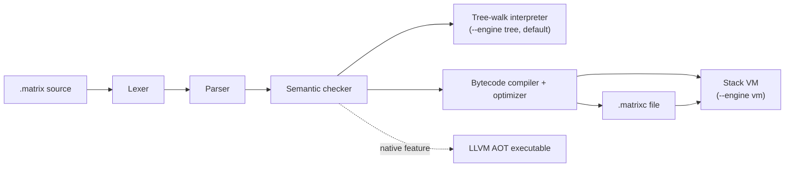

# Spid3r

**A small, dynamically typed programming language with optional static types, written in pure Rust.**

Spid3r programs (`.matrix` files) run on two interchangeable engines — a tree-walking
reference interpreter and a bytecode compiler with a stack VM — that are tested to produce
identical output. The core toolchain has **zero third-party dependencies**.

```text
fn main() {
    println("Hello, Spid3r!");
    return 0;
}
```

```sh
$ spid3r run hello.matrix
Hello, Spid3r!
```

---

## Contents

- [Features](#features)
- [Getting started](#getting-started)
- [Language tour](#language-tour)
- [Execution model](#execution-model)
- [Command-line reference](#command-line-reference)
- [Projects and dependencies](#projects-and-dependencies)
- [Backends](#backends)
- [Testing](#testing)
- [Documentation](#documentation)
- [Known limitations](#known-limitations)
- [License](#license)

## Features

- **Readable syntax**: `fn`, `let`, `const`, `if`/`elif`/`else`, `while`, `for … in`, C-style `for`.
- **First-class functions and closures** that capture their surrounding variables.
- **Classes and interfaces**: single inheritance (`extends`), `implements`, and
  `public`/`private` members (private by default, enforced at check time).
- **Structured errors**: `throw`, `try`/`catch`/`finally`, plus `option` (`some`/`none`)
  and `result` (`ok`/`err`) values for expected failures.
- **Gradual typing**: optional annotations (`a: int`, `-> string`), checked before the program runs.
- **20+ built-in data structures**: `list`, `map`, `set`, `stack`, `queue`, `deque`,
  `heap`, `priority_queue`, `bst`, `trie`, `graph`, `matrix`, linked lists, and more.
- **Concurrency**: `spawn` tasks on a threaded scheduler, `async`/`await`, `channel`, `mutex`, `ref`.
- **Modules** with explicit `public` exports, and a package manager with lockfiles.
- **Tooling**: formatter, REPL, line debugger, benchmark runner, and differential tester.
- **Backends**: a desktop webview GUI and an LLVM ahead-of-time compiler for native executables (both built by default).

## Getting started

### Install

**Linux / macOS** — one-line installer (curl or wget, POSIX `sh`):

```sh
curl -fsSL https://raw.githubusercontent.com/needyamin/spid3r/main/install.sh | sh
```

The script detects your architecture, downloads the matching release tarball from GitHub,
installs `spid3r` into `~/.spid3r/bin`, and adds that directory to your `PATH` in
`~/.bashrc`, `~/.zshrc`, and `~/.profile`. Options:

```sh
sh install.sh --version 0.1.0   # pin a release instead of latest
sh install.sh --dir ~/.local/bin
sh install.sh --source          # build from source via cargo (no release needed)
```

**Windows** — run the NSIS installer `Spid3r-Setup-<version>.exe` from the repository root
(or a release), or build from source as shown below.

### Build from source

You need a recent stable Rust toolchain (edition 2021) and, for the default build, LLVM 18.1+
(see [Backends](#backends) to build without it).

```sh
cargo build --release        # binary at target/release/spid3r (spid3r.exe on Windows)
cargo test                   # run the full test suite
```

On Windows, `cargo build --release` also writes the installer `Spid3r-Setup-<version>.exe` to
the repository root, using NSIS from `packaging/nsis/nsis/nsis-3.10/` or `PATH` (the step is
skipped with a warning when NSIS is missing). Set `SPID3R_NO_INSTALLER=1` to skip it.

### Run your first program

```sh
spid3r run examples/hello.matrix              # tree-walking interpreter (default)
spid3r run --engine vm examples/hello.matrix  # bytecode VM
spid3r repl                                   # interactive prompt
```

Every program needs a `fn main()`. If `main` returns an integer, that integer becomes the
process exit code.

## Language tour

All snippets below run unchanged on both engines. The output is shown in comments.

### Variables, functions, and collections

```text
const LIMIT = 3;

fn add(a: int, b: int) -> int {            // type annotations are optional
    return a + b;
}

fn make_counter() {
    let count = 0;
    return fn() {                          // closure captures `count`
        count += 1;
        return count;
    };
}

fn main() {
    let xs = list(1, 2, 3, 4, 5);
    println(xs.filter(fn(x) { return x % 2 == 0; }));        // [2, 4]
    println(xs.reduce(0, fn(acc, x) { return acc + x; }));   // 15

    let tick = make_counter();
    tick();
    println(tick());                                         // 2

    for i in [1, 2, 3] {
        if i == LIMIT { break; }
        println("i={}".format(i));                           // i=1, i=2
    }

    let ports = map("http", 80, "https", 443);
    ports["ssh"] = 22;
    println(ports.keys());                                   // [http, https, ssh]
    println(add(2, 3));                                      // 5
    return 0;
}
```

### Classes and interfaces

```text
interface Shape {
    fn area(self) -> float;
}

class Rect implements Shape {
    public let w;
    public let h;

    fn new(w, h) {                 // constructor, called via `new Rect(...)`
        self.w = w;
        self.h = h;
    }

    public fn area(self) -> float {
        return float(self.w * self.h);
    }
}

class Square extends Rect {
    fn new(side) {
        self.w = side;
        self.h = side;
    }
}

fn main() {
    for s in [new Rect(2, 3), new Square(4)] {
        println(s.area());         // 6.0, then 16.0
    }
    return 0;
}
```

### Error handling

```text
fn parse_age(s) {
    let n = int(s);
    if n < 0 {
        return err("age cannot be negative");
    }
    return ok(n);
}

fn main() {
    try {
        println(10 / 0);
    } catch (e) {
        println("caught: " + e);                  // caught: division by zero
    } finally {
        println("cleanup");                       // always runs
    }

    let r = parse_age("-1");
    if r.is_err() {
        println(r.unwrap_err());                  // age cannot be negative
    }
    println(parse_age("42").unwrap_or(0));        // 42
    return 0;
}
```

If an error is never caught, the program prints its source position and a stack trace,
then exits with code `1`. File and process builtins (`read_file`, `write_file`,
`spawn_process`) return `result` values instead of throwing.

### Concurrency

```text
async fn sum(a, b) {
    return await a + await b;                     // `await` is only valid inside `async fn`
}

fn main() {
    let t1 = spawn fn() { return 20; };
    let t2 = spawn fn() { return 22; };
    println(sum(t1, t2));                         // 42

    let ch = channel();
    spawn fn() { ch.send("ping"); };
    println(ch.recv());                           // ping
    return 0;
}
```

Tasks also expose `status()`, `join()`, and `is_done()`. A failed task re-raises its
error when joined.

### Modules

```text
// math_util.matrix — a library: no main, only `public` names are exported
public fn square(x) { return x * x; }
fn helper() { return 42; }                        // private to this file

// modules.matrix
import "math_util";

fn main() {
    println(square(5));                           // 25
    return 0;
}
```

Imports are resolved next to the importing file first, then on `SPID3R_PATH`, then in
`./stdlib`, and finally in the project's `vendor/` directory.

### Semantics at a glance

| Topic | Behavior |
|---|---|
| Primitive types | `int` (64-bit), `float` (64-bit), `bool`, `string` (immutable UTF-8), `null` |
| Arithmetic | `int + float` gives a `float`; `7 / 2` is `3`; integer overflow wraps; dividing by zero throws |
| Equality | `1 == 1.0` is `true` |
| Logic | `and`, `or`, `not` (short-circuit); there is no `!`, `++`, or `**` (use `pow`) |
| Truthiness | `null`, `false`, `0`, `0.0`, `""`, and `none` are falsy |
| Comments | `// line` and `/* block */` |

For the complete grammar, see [`docs/GRAMMAR.md`](docs/GRAMMAR.md).

## Execution model



1. **Front end.** Lexing, parsing, and semantic checking are shared by every engine. The
   checker catches unknown names, private-member access, arity errors, and type-annotation
   mismatches before any code runs.
2. **Tree-walk interpreter.** The reference implementation, and the default engine for `run`.
3. **Bytecode VM.** Compiles the checked syntax tree to bytecode, then optimizes it with
   constant folding, peephole rewrites, and dead-code elimination (`--no-opt` disables the
   optimizer). Both engines share one value and runtime layer, which is what keeps their
   output identical.
4. **`.matrixc` files.** `spid3r compile` writes self-contained bytecode with every
   imported module embedded, so `spid3r exec` needs no source files. Bytecode is validated
   before execution: malformed input becomes a clean error, never a crash.

**Memory.** Values are reference-counted and thread-safe, so they can cross `spawn`
boundaries. A cycle collector runs automatically and reclaims reference cycles through
lists, vecs, sets, maps, and class instances. Set `SPID3R_GC=0` to turn it off, or call
`gc_collect()` to force a collection. For back-references in other containers, use
`weak(v)` and `deref(w)`. See [`docs/GC.md`](docs/GC.md).

## Command-line reference

| Command | Description |
|---|---|
| `spid3r run [--engine tree\|vm] [--no-opt] <file> [args…]` | Check and run a program; extra arguments are available through `args()` |
| `spid3r check <file>` | Lex, parse, and semantic-check without running |
| `spid3r compile <file> [-o out] [--dump] [--no-opt]` | Write bytecode (`.matrixc`); `--dump` prints the disassembly |
| `spid3r exec <file.matrixc>` | Run compiled bytecode on the VM |
| `spid3r repl` | Interactive prompt (`:help`, `:quit`) |
| `spid3r fmt [--check] [files…]` | Format files in place; `--check` exits `1` if any file would change |
| `spid3r debug <file> [--break L,…] [--commands FILE]` | Line debugger: breakpoints, step/next/finish, backtrace, locals |
| `spid3r test` | Run every `examples/*.matrix` on the tree interpreter, the VM, and compile + exec, and compare their output |
| `spid3r bench [--engine tree\|vm] [--runs N] [--compare] [files…]` | Time `benchmarks/*.matrix`, keeping the best of N runs |
| `spid3r init [dir]` | Create `spider.toml` and `src/main.matrix` |
| `spid3r install` | Vendor dependencies into `vendor/` and write `spider.lock` |
| `spid3r dist [-o out] [--no-opt]` | Compile the project entry to `target/<package>.matrixc` |
| `spid3r pack [-o out.tar]` / `spid3r unpack <archive> [dir]` | Archive a project into a tarball, or extract one |
| `spid3r build <file> [-o out] [--target triple] [--release]` | Build a native executable (`native` feature) |
| `spid3r gui <file> [--html page.html] [--dry-run]` | Run a program in a webview window (`gui` feature) |
| `spid3r version` / `spid3r help` | Print version or usage |

**Exit codes:** `0` means success, `1` means a program error, and `2` means a usage error.
A program's own exit code comes from the integer returned by `main`.

## Projects and dependencies

```sh
spid3r init myproj && cd myproj
spid3r run            # with no file argument, runs the manifest's entry
```

```toml
# spider.toml
[package]
name = "myproj"
version = "0.1.0"
entry = "src/main.matrix"

[dependencies]
mathlib = { path = "../mathlib" }                            # local path
extras  = { git = "https://example/extras", rev = "main" }   # git, pinned to a commit
serde   = { version = "^1.0" }                               # offline registry ($SPID3R_REGISTRY)
```

- `spid3r install` copies dependency sources into `vendor/` and writes a deterministic
  `spider.lock`, with a SHA-256 hash for each dependency.
- `[workspace] members = [...]` lets several packages share one `vendor/` and one lockfile.
- Inside a project, `spid3r test` runs `tests/*.matrix` on both engines. Write tests with
  `assert` and `assert_eq`.

There is no remote package registry. Dependencies of registry packages are not resolved
transitively. See [`docs/REGISTRY.md`](docs/REGISTRY.md).

## Backends

Both backends are on by default, and the Windows installer ships both.

```sh
cargo build --release                                        # core + GUI + LLVM compiler (needs LLVM 18.1+)
cargo build --release --no-default-features --features gui   # core + GUI, no LLVM needed
cargo build --release --no-default-features                  # core toolchain only, zero dependencies
```

- **Native (`spid3r build`).** Compiles a program to a standalone machine-code executable.
  Runtime operations reuse the VM's value code, so the output matches the interpreters.
  `spid3r.exe` loads `LLVM-C.dll`, and linking a program needs MSVC Build Tools with the
  Windows SDK; the built executables have no LLVM dependency. See
  [`docs/NATIVE.md`](docs/NATIVE.md) and [`docs/BUILDING.md`](docs/BUILDING.md).
- **GUI (`spid3r gui`).** Programs call `gui_set_html`, `gui_eval`, `gui_on`, `gui_emit`,
  and `gui_title`, and the page calls `window.spid3r.emit(event, payload)`. With
  `--dry-run`, the bridge runs without a window. See [`docs/GUI.md`](docs/GUI.md) and
  `examples/gui/counter.matrix`.

## Testing

Correctness in Spid3r means *the engines agree*, so testing is differential:

- `cargo test` runs the unit, integration, parity-regression (`tests/audit_regressions.rs`),
  fuzzing (`tests/fuzz_tests.rs`), and differential tests.
- `spid3r test` runs every example three ways (tree interpreter, VM, and compile + exec)
  and requires identical output.
- `spid3r bench --compare` also asserts that the tree interpreter and the VM print the same output.
- Audit findings and verification notes are documented in [`docs/AUDIT_REPORT.md`](docs/AUDIT_REPORT.md).

## Documentation

| Document | Contents |
|---|---|
| [Developer guide](https://needyamin.github.io/spid3r/doc.html) | Full developer guide, online (source: `doc.html`) |
| [`docs/GRAMMAR.md`](docs/GRAMMAR.md) | EBNF grammar and precedence rules |
| [`docs/KEYWORDS.md`](docs/KEYWORDS.md) | Reserved words |
| [`docs/STANDARD_LIBRARY.md`](docs/STANDARD_LIBRARY.md) | Global functions |
| [`docs/DATA_STRUCTURES.md`](docs/DATA_STRUCTURES.md) | Built-in containers and their methods |
| [`docs/BYTECODE.md`](docs/BYTECODE.md) | `.matrixc` format and VM design |
| [`docs/GC.md`](docs/GC.md) | Cycle collector |
| [`docs/NATIVE.md`](docs/NATIVE.md) · [`docs/BUILDING.md`](docs/BUILDING.md) | LLVM backend and build setup |
| [`docs/GUI.md`](docs/GUI.md) | Webview GUI layer |
| [`docs/REGISTRY.md`](docs/REGISTRY.md) | Local dependency registry |
| [`docs/ROADMAP.md`](docs/ROADMAP.md) | Roadmap and limitations |
| [`docs/AUDIT_REPORT.md`](docs/AUDIT_REPORT.md) | Codebase audit report and regression summary |

Runnable examples live in [`examples/`](examples/). Run any of them with
`spid3r run examples/<name>.matrix`.

## Known limitations

- Exponent float literals such as `1.5e3` are not supported, and
  `-9223372036854775808` cannot be written as a literal.
- The native backend rejects classes declared inside a function.
- Dependencies are local only: path, git, or an offline registry directory.

## License

MIT, as declared in [`Cargo.toml`](Cargo.toml).
