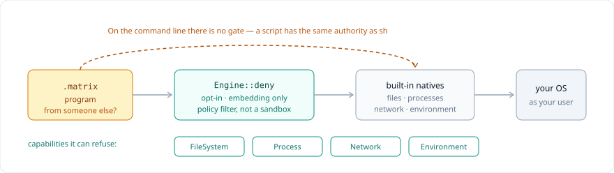

# Security policy

**A Spid3r script is code, not data.** A `.matrix` program runs with the full authority of the process that starts it — it can read files, open sockets, spawn children and read the environment, exactly like `sh`.

The only rule that matters: **if you did not write the script, treat it like a native binary from the same source.**

## Supported versions

| Version | Supported |
|---|---|
| 1.0.x | yes |
| < 1.0 | no |

## Report a vulnerability

**Do not open a public issue.** Use GitHub's private reporting:

→ **https://github.com/needyamin/spid3r/security/advisories/new**

Include:

- `spid3r version` output and your platform
- the smallest program that reproduces it
- what you expected vs. what happened

Targets: acknowledge within **7 days**, ship a fix or mitigation for critical issues within **30 days**.

## In scope

| Class | Example |
|---|---|
| Memory safety | panic or UB in the toolchain reachable from a `.matrix` program |
| Capability escape | a `deny`-ed native still reachable from an embedded script |
| Hostile input | malformed `.matrixc`, corrupt payload trailer, hostile TOML/YAML/XML/JSON |
| Path traversal | `bundle`, `pack`, `unpack`, `install` writing outside the target |
| Crypto misuse | bcrypt, HMAC, PBKDF2, Argon2, session signing |
| Supply chain | a `spider.lock` pin that can be bypassed or silently re-resolved |

## Not a vulnerability

| Reported as | Why it is the documented model |
|---|---|
| "a script read my files" | scripts have process authority by design — see the diagram |
| "an infinite loop hangs the process" | cap it with `--budget N` or OS limits |
| "session payload is readable" | sessions are signed, not encrypted; don't store secrets |
| "no CSRF middleware" | known gap, listed below — add one or use `SameSite` + origin check |

## Hardening

- **Running untrusted code:** separate user, container, or VM. `Engine::deny` is a policy filter, not a sandbox.
- **Embedding in Rust:** `Engine::new().deny_all()`, then grant only what the script needs.
- **Bounding work:** `spid3r run --budget N` caps execution for untrusted input.

## Known gaps

| Gap | Status |
|---|---|
| No per-path filesystem scope, per-host allowlist, or memory ceiling | open |
| Native (LLVM) backend less exercised than tree/VM | beta for hostile input |
| GUI/webview backend smoke-tested only | open |
| No CSRF middleware in the web stack | open |
| Sessions are client-readable (signed, not encrypted) | by design |
| Hand-written `--embed` launchers keep the lenient payload fallback | call `run_payload_strict()` |

## Deeper reading

| Document | |
|---|---|
| [Security model](docs/SECURITY.md) | trust model, concurrency rules, crypto, packaged apps |
| [Audit report](docs/AUDIT_REPORT.md) | findings and their fixes |
| [Audit status](docs/AUDIT_STATUS.md) | what is still open |
