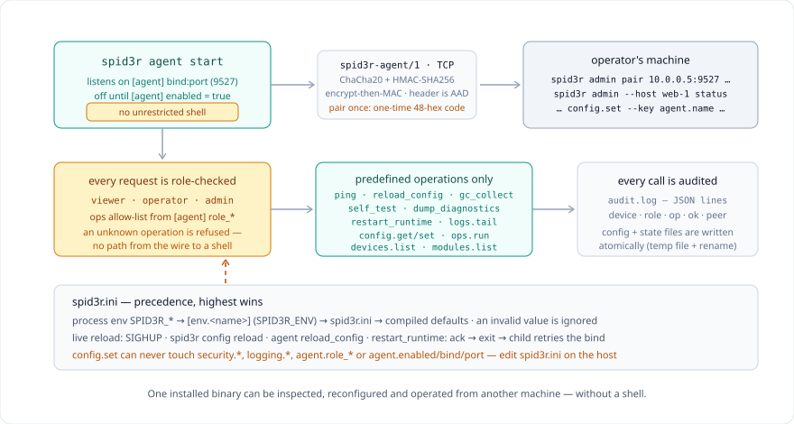

# Runtime configuration and remote management

Spid3r ships a self-describing runtime: one `spid3r.ini`, one `spid3rinfo()`,
and one encrypted management agent. This page is the operator manual. The
implementation lives in `src/config/`, `src/runtime_info/`, `src/agent/` and
`src/crypto/`.



## 1. `spid3r.ini`

A single INI file configures the runtime. Search order (first hit wins):

1. `$SPID3R_INI`
2. `spid3r.ini` next to the `spid3r` executable
3. platform config dir (`%APPDATA%\Spid3r`, `$XDG_CONFIG_HOME/spid3r`, `~/.config/spid3r`)
4. `./spid3r.ini`

`spid3r config init` writes a commented default. `spid3r config path` prints
the search list. `spid3r config validate` reports unknown keys and type
errors; it never aborts a run. Every layer is validated with the same
rules: a value from the INI file, an `[env.<name>]` section, or a process
env var that fails its type/range check is ignored with a note and the
compiled default stays in effect (a bool must be one of
`true/false/1/0/on/off/yes/no`; a typo like `ture` is an error, not a
silent true). A UTF-8 BOM at the start of the file is tolerated.

Precedence, highest first:

1. process environment (`SPID3R_<SECTION>_<KEY>`, plus the documented
   `SPID3R_MAX_WORKERS`, `SPID3R_GC`, …)
2. `[env.<name>]` where `<name>` is `SPID3R_ENV` or `[spid3r] env`
3. the INI file
4. compiled defaults (`src/config/schema.rs`)

Live reload: `spid3r config reload`, `SIGHUP` on Unix, or
`POST /api/v1/config/reload` on the agent.

```ini
[spid3r]
engine = vm
max_workers = 256
gc = true

[runtime]
wall_clock_limit_ms = 0    ; fatal execution deadline in ms; 0 = unlimited
memory_limit_mb = 0        ; soft cap on script-value heap (catchable); 0 = unlimited
timezone = UTC             ; UTC, a fixed offset like +06:00, or an IANA name

[net]
timeout_ms = 30000         ; HTTP framing deadline in ms (slowloris guard); 0 disables
max_body = 8388608         ; largest accepted request body in bytes (413 above it)
max_headers = 64           ; most request headers accepted (431 above it)
keepalive_ms = 5000        ; idle window between keep-alive requests; 0 = close after each

[errors]
level = info               ; error|warn|info — minimum surfaced diagnostic level
display = false            ; mirror diagnostic log lines to stderr
log_file =                 ; dedicated error-log path; empty = shared log only

[agent]
enabled = false
bind = 127.0.0.1         ; 0.0.0.0 to accept other hosts
port = 9527

[modules]
disable =                ; module names that fail to import (';' or ',' separated)
assert_active = true     ; false makes assert()/assert_eq() no-ops returning true

[security]
allow_remote = false
basedir =                ; open_basedir analog: paths scripts may touch
disable_natives =        ; natives replaced by a catchable denial
                         ; WARNING: basedir alone is NOT a jail — Process
                         ; natives (spawn_process/exec_capture) reach any
                         ; path the OS user can. Pair them, e.g.:
                         ; disable_natives = spawn_process, exec_capture, run_payload, run_payload_strict

[packages]
registry =               ; canonical registry directory (alias: SPID3R_REGISTRY)
allow_insecure_git = false
allow_local_git = false

[env.production]
agent.enabled = true
agent.bind = 0.0.0.0
```

Run-time limits: `runtime.wall_clock_limit_ms` arms a wall-clock deadline for
`spid3r run` — expiry is a **fatal**, uncatchable `wall-clock limit exceeded
(N ms)` error on the tree and VM engines, checked at statement boundaries,
at the VM's instruction poll, and around blocking native calls (so the
residual granularity is one blocking operation). The native AOT backend is
not wired to it (same treatment as `--max-call-depth`). Deadline and cap are
Arc-shared with spawned tasks and module interpreters, and `config reload`
applies new values live to a running process. `runtime.memory_limit_mb` is a
**catchable** soft cap on the total heap used by script values (`out of
memory: script exceeded memory_limit_mb (N)` — PHP-style, a program may
catch it, drop the offending container, and continue). Accounting covers
every tracked heap cell (containers, instances, closures, classes), counting
strings by byte length and containers by element count; free-standing values
in untracked environments (plain `let` scalars and strings that never live
inside a tracked container) are not counted, and the estimate refreshes at
most every 25 ms, so the cap is approximate by design. `runtime.timezone`
sets the default zone for the datetime natives: `UTC` (the default), a fixed
offset like `+06:00`, or an IANA name from `tz_names()` — anything else is
rejected at load time with a note and UTC stays in effect.

HTTP serving limits (`net.*`): `net.timeout_ms` is the framing deadline a
connection gets when it enters HTTP parsing (the slowloris guard; `0`
disables it) — `SPID3R_NET_TIMEOUT_MS` is its env alias. `net.max_body` caps
the request body (a larger body is rejected with `413` before the handler
runs), `net.max_headers` caps the request header count (rejected with `431`),
and `net.keepalive_ms` is the idle window between keep-alive requests (`0`
closes after each response). A server may override all four per listen via
its options map (`timeout_ms`, `max_body_bytes`, `max_headers`,
`idle_timeout_ms` — see `docs/STANDARD_LIBRARY.md` §29); an explicit option
beats the INI default. All four are re-read per accepted connection, so
`config reload` applies to connections accepted afterwards.

Script-surface policy keys: `security.basedir` is an open_basedir analog —
when non-empty, every native that takes a script-controlled path (read,
write, delete, rename, copy, list, stat, `chdir`, the npy/CSV file natives,
`db_open`, `tcp_recv_to_file`, `tcp_send_file`) may only touch paths inside
the listed directories (`;` or `,` separated); see `docs/SECURITY.md` for
the guarantees and limits. **basedir alone is not a jail**: with the default
Process capability, `spawn_process`/`exec_capture` still reach any path the
OS user can through the child process — pair basedir with
`disable_natives = spawn_process, exec_capture, run_payload,
run_payload_strict` (or run under `--sandbox`) for meaningful confinement.
`security.disable_natives` replaces the named
natives with a catchable `disabled by configuration` denial (unknown names
are noted and ignored). `modules.disable` makes importing the named modules
fail with `module disabled by configuration: '…'` — the name comparison
follows the platform's default file-name case rules (case-insensitive on
Windows and macOS like NTFS and the APFS default, case-sensitive on Linux).
These three are read once per process
(a script cannot widen them with `config_set` mid-run) and are frozen for
remote `config.set`. `modules.assert_active = false` turns
`assert()`/`assert_eq()` into no-ops returning `true` (the zend.assertions
analog). `packages.registry` is the canonical home of the
`SPID3R_REGISTRY` env alias; `packages.allow_insecure_git` and
`packages.allow_local_git` are the canonical homes of
`SPID3R_ALLOW_INSECURE_GIT` and `SPID3R_ALLOW_LOCAL_GIT_DEPS` — the env
spellings keep working as generic aliases.

Diagnostics: `errors.level` (`error|warn|info`, default `info`) gates the
script-visible diagnostics channel — diagnostics below the level are not
surfaced. `errors.display` mirrors diagnostic log lines to stderr; it is the
canonical spelling of the documented `debug.log_stdout` alias (both work; an
explicit `errors.display` in any layer wins, otherwise the alias applies).
`errors.log_file` routes error-level diagnostics to a dedicated file when
set; empty (the default) keeps the current behavior of the shared diagnostic
log only.

Scripts read and write the live values with `config_get(key)`,
`config_set(key, value)` and `config_reload()`. Sensitive-looking values are
redacted on read unless the caller is local.

`[logging] enabled`, `[logging] file` and `[logging] audit` are honored
(for this process; the `SPID3R_LOG` / `SPID3R_LOG_FILE` env vars override
the INI values). All config state files are written atomically
(temp file + rename), so a crash mid-write cannot truncate them.

## 2. `spid3rinfo()`

Spid3r's own runtime introspection. One collector, three renderers, one
redaction pass.

| Call | Result |
|---|---|
| `spid3rinfo()` | map of `section -> {key: value}` |
| `spid3rinfo("html")` | standalone HTML page |
| `spid3rinfo("json")` | JSON string |
| `spid3rinfo("text")` | aligned plain text |
| `spid3rinfo("map", true)` | map without redaction (local operator choice) |

CLI:

```console
$ spid3r info            # text
$ spid3r info --json
$ spid3r info --html
$ spid3r info --no-redact
```

Sections: Spid3r (version, language, Rust, profile), System (OS, arch,
memory, CPUs), Installation (exe, ini, log, state), Features (`gui`,
`native (LLVM AOT)`, `tls`, `plugins-wasm`, `agent`, `spid3rinfo`),
Modules (embedded stdlib, plugins), Configuration, Environment, Memory,
Agent. On `wasm32` (the playground build) the Environment and Agent
sections are omitted — there is no OS process or environment there.

Keys containing or ending in `password`, `passwd`, `pwd`, `passphrase`,
`token`, `secret`, `shared`, `credential`, `authorization`, `cookie`,
`api_key`, `apikey`, `private`, or any `…_key` / `…-key` name
(`signing_key`, `access_key`, …) are replaced with
`[redacted sha256:<12 hex>]`. Remote callers never receive unredacted output.

Two phase-3 policy keys get the stricter treatment on the remote side:
`security.basedir` maps the host's directory layout and
`security.disable_natives` reveals exactly which natives a script may reach
— reconnaissance either way — so the agent's remote `info` and `config.get`
redact them as well. They are not credentials: the local CLI, local
`spid3r info` and scripts (which are the *subject* of the policy and can
probe both lists by observation) keep reading them raw.

## 3. Management agent

`spid3r agent start` listens on `[agent] bind:port` and speaks
`spid3r-agent/1` over TCP. There is **no unrestricted shell**. Every
operation is a predefined name checked against the caller's role.

```console
$ spid3r agent start
$ spid3r agent pair --role operator --name laptop-1
pairing code (operator): 9f2c…        # 48 hex chars, single use, short TTL
$ spid3r agent status
$ spid3r agent ops
```

On the administrator's machine:

```console
$ spid3r admin pair 192.168.1.10:9527 9f2c… --name laptop-1
$ spid3r admin --host laptop-1 ping
$ spid3r admin --host laptop-1 status
$ spid3r admin --host laptop-1 info
$ spid3r admin --host laptop-1 config.get --key agent.port
$ spid3r admin --host laptop-1 config.set --key agent.name --value web-1
$ spid3r admin --host laptop-1 logs.tail --lines 80
$ spid3r admin --host laptop-1 modules.list
$ spid3r admin --host laptop-1 devices.list
$ spid3r admin --host laptop-1 ops.run --op-name self_test
$ spid3r admin --host laptop-1 reload
```

Predefined operations (`ops.run --name …`):

`ping`, `reload_config`, `rotate_log`, `gc_collect`, `self_test`,
`dump_diagnostics`, `restart_runtime`.

`rotate_log` rotates both `spid3r.log` and `audit.log` immediately (each is
renamed to `<name>.1`, replacing any previous `.1`) and returns both new
paths in its response.

`restart_runtime` acknowledges the caller first, then exits and spawns the
same executable; the new process retries its bind for a few seconds so the
handover cannot lose the port. In production run the agent under a service
manager (Windows service, systemd unit) and treat exit as "the manager
restarts it".

### Remote `config.set` restrictions

`config.set` only accepts known, validated keys — and a fixed set of
security-relevant keys **cannot be changed remotely at all**. The set is
**derived from the schema** (`frozen` on each key in
`src/config/schema.rs`), not a hand-written list, so a new key cannot
silently forget the classification; a pin test holds the exact set:

* every `security.*` key (deny switches, `allow_remote`, `basedir`,
  `disable_natives`)
* every `logging.*` key (audit trail, log target/switch, rotation)
* `agent.role_viewer` / `role_operator` / `role_admin` (an operator must
  not be able to grant itself more operations)
* `agent.enabled`, `agent.bind`, `agent.port`, `agent.max_connections`,
  `agent.request_timeout_ms`, `agent.max_body` (a remote change would take
  effect on the next restart)
* `modules.disable` and the two git-transport opt-ins
  `packages.allow_insecure_git` / `packages.allow_local_git`

Change these by editing `spid3r.ini` on the host (or via the local CLI).
Benign keys — e.g. `agent.name`, `packages.registry`,
`modules.assert_active` — stay remotely settable. `packages.registry` is a
deliberate trade-off, not an oversight: a compromised remote channel could
redirect the install source, and a **first** install from a redirected
registry trusts its `sha256.txt`; `spider.lock` protects re-installs only.
Operators who treat that as unacceptable should keep the key out of remote
reach by editing the ini and restricting the `config.set` operation in
`agent.role_operator`.

### Roles

| Role | May call |
|---|---|
| `viewer` | `status`, `ping`, `info`, `config.get`, `logs.tail`, `modules.list`, `devices.list` |
| `operator` | viewer + `config.set`, `ops.run`, `config.reload` |
| `admin` | everything, including `devices.revoke` and `pair.create` |

Lists are configurable via `agent.role_viewer` / `role_operator` /
`role_admin` (`*` = all).

### Pairing and encryption

Pairing is out-of-band: the host prints a 192-bit one-time code; the client
sends it once. Both sides derive the long-term shared key as
`SHA-256(code)`. The shared key **never crosses the wire**. The code is
single-use and expires (`agent.pairing_ttl_sec`, default 300s). A connection
that fails pairing five times is closed by the agent, so code guessing pays
a fresh TCP connect per batch of attempts.

After pairing, every data frame is:

```
magic "SPID3R01" | version | kind | device[16] | nonce[12] | len u32 | payload
```

`kind = pair` is plaintext JSON (the code is the secret).
`kind = data` is ChaCha20 encrypted and HMAC-SHA256 authenticated
(encrypt-then-MAC). Subkeys come from HKDF-SHA256. The frame header is AAD,
so a swapped payload fails the tag. Nonces are random 96-bit values; the
server keeps a **server-wide** replay window (device + nonce, entries expire
after ~1 hour, capped at 4096 frames) — a captured frame cannot be replayed
on a fresh connection or after a restart. A frame whose declared size
exceeds `agent.max_body` (+16 bytes of tag) is rejected straight after the
header, before the body is read.

There is no TLS and no certificate store. The same protocol runs on
Windows, Linux and macOS. Bind `127.0.0.1` unless you actually need other
hosts; put a firewall in front of `0.0.0.0`.

### Audit

Every accepted or rejected operation is one JSON line in
`<state>/audit.log`:

```json
{"ts":1762252800,"device":"laptop-1","role":"operator","op":"config.set","ok":true,"peer":"192.168.1.4:51000","detail":""}
```

The audit log rotates at 1 MiB: the current file is renamed to
`audit.log.1` and a fresh `audit.log` starts. Disable with
`[logging] audit = false`.

### State files

| Path | Contents |
|---|---|
| `<state>/devices.json` | paired devices (id, name, role, shared key) |
| `<state>/clients.json` | admin-client known hosts |
| `<state>/audit.log` | append-only audit |

`<state>` is `%LOCALAPPDATA%\Spid3r\state`, `$XDG_STATE_HOME/spid3r`, or
`SPID3R_STATE_DIR`. `devices.json` and `clients.json` are `0600` on Unix.

## 4. Security notes

* Scripts still run with process authority (see `docs/SECURITY.md`). The
  agent does not change that. It is a management plane, not a sandbox.
* No `exec`, no `spawn_process`, no path-based file write. `config.set`
  only accepts known, validated keys — and the security-relevant ones are
  not settable remotely at all (see "Remote `config.set` restrictions").
  `config.set` cannot disable the audit trail or re-bind the listener.
* Remote `info` and `config.get` are always redacted.
* A stolen `devices.json` is game over for that host: rotate by revoking
  the device and re-pairing. Keep the file off backups you do not encrypt.
* Pairing should happen on a network you trust. The code is high-entropy
  and short-lived, but it is not a PAKE.

## 5. Cross-platform

| Concern | Windows | Linux | macOS |
|---|---|---|---|
| Config dir | `%APPDATA%\Spid3r` | `$XDG_CONFIG_HOME/spid3r` | `~/.config/spid3r` |
| State dir | `%LOCALAPPDATA%\Spid3r\state` | `$XDG_STATE_HOME/spid3r` | `~/.local/state/spid3r` |
| Log | same tree as today | same | same |
| Reload | `config reload` / agent | `SIGHUP` + those | `SIGHUP` + those |
| CSPRNG | `RtlGenRandom` | `/dev/urandom` | `/dev/urandom` |
| Memory info | `GlobalMemoryStatusEx` | `/proc/meminfo` | `sysctl hw.memsize` |

No third-party crates were added. The agent, INI parser, ChaCha20, HMAC,
HKDF and Poly1305 (unused, kept with a vector) are in-tree.
