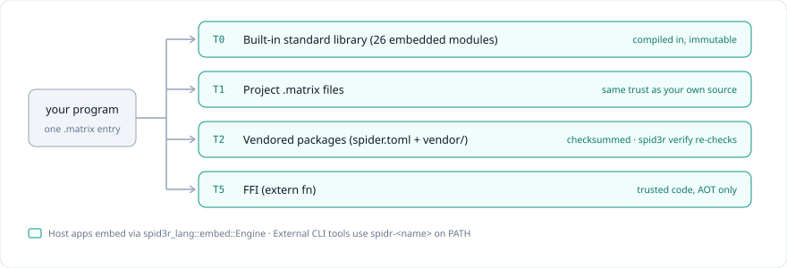

# The Spid3r ecosystem

How third-party code reaches a Spid3r program, what each route is allowed to do,
and which parts exist today.

Status: every route on this page is implemented. `spidr-<name>` external tools,
packages, and native FFI.

## 0. Code routes, at a glance



## 1. How code enters a program

| Route | Today | Trust | Notes |
| --- | --- | --- | --- |
| Embedded stdlib | ✅ | T0 | Compiled into the binary; immutable, no disk override from the install tree |
| Project `.matrix` files | ✅ | T1 | Same trust as the project's own source |
| Vendored packages (`vendor/`, `spider.lock`) | ✅ | T2 | Checksummed on install |
| FFI (`extern fn`) | ✅ | T5 | **Trusted code**, AOT-only — see `docs/FFI.md` |

The trust tiers rank routes by who controls the code, from T0
(immutable, compiled in) to T5 (arbitrary trusted native code). The one rule
that matters most: **capability filtering is a policy filter, not a sandbox.**
It replaces known builtin natives with stubs that return a catchable `capability denied`
error.

## 2. `spidr-<name>` external tools

Any executable named `spidr-<name>` on `PATH` is a Spid3r subcommand:

```console
$ spid3r fmt-ext main.matrix     # runs spidr-fmt-ext with ["main.matrix"]
$ echo $?
0
```

Rules, all enforced in `src/cli.rs`:

* **Built-ins always win.** `spid3r version` never looks for `spidr-version`.
* **The exit code is the tool's.** `0`, `1` and `2` keep their documented
  meanings (success, user-program error, usage error); any other code is passed
  through unchanged; death by signal maps to `1`.
* **Arguments are forwarded verbatim**, after the subcommand name.
* **`--help` reaches the tool.** `spid3r fmt-ext --help` runs `spidr-fmt-ext`
  with `--help`; the tool's own help is what the user sees. An unknown command
  whose tool does not exist still gets Spid3r's help appended to the usage
  error, so the output never leaves the user without a next step.
* **The name is validated before any lookup.** The executable path is built by
  concatenation (`spidr-` + name), so a name starting with `-` or `.`,
  containing a path separator, a drive/UNC prefix, or a `..` component is
  rejected with the ordinary unknown-command usage error.
  `spid3r ../../bin/sh` runs nothing.
* **On Windows, only `.exe` and `.com` are dispatched.** Batch shims
  (`.bat`/`.cmd`) are excluded on purpose: `cmd.exe` re-parses the command line
  it is handed, so a single argument containing `&` or `|` becomes a second
  command. A tool invoked as `spid3r lint "$PR_FILE"` would then execute whatever
  a pull request put in the filename. Git for Windows refuses to dispatch to
  batch files for the same reason. Ship a real executable instead.
* **`PATH` is honoured per platform.** Entries are split with the platform
  separator; empty entries are skipped; a *relative* entry such as `.` is
  honoured as given, exactly as the shell does.

This is the cheapest extension point in the ecosystem: no ABI, no manifest, no
version negotiation. It is also the only one that needs no cooperation from the
language — which is why it shipped first.

### Why no embedded plugin host

Spid3r deliberately does not embed a WASM or native plugin host inside the CLI.
External CLI tools use `spidr-<name>` executables on `PATH` (described above),
Rust host applications embed Spid3r via `spid3r_lang::embed::Engine`, and native
libraries bind via `extern fn` (C FFI). Keeping those boundaries separate avoids
coupling the core compiler/runtime to a custom plugin ABI.

## 3. Writing an external tool

A tool is a normal executable. It receives the arguments the user typed after
the subcommand name, and whatever it prints is what the user sees.

```sh
#!/bin/sh
# spidr-fmt-ext — an external formatter for .matrix files.
set -eu
for f in "$@"; do
  [ -f "$f" ] || { echo "no such file: $f" >&2; exit 2; }
done
echo "formatted $# file(s)"
```

Two conventions worth following, because they are what the built-ins do:

* **Exit 2 for usage errors, 1 for "the user's input is wrong", 0 for success.**
  A tool that exits 0 after failing silently makes the whole command
  untrustworthy.
* **Write diagnostics to stderr**, never stdout — stdout belongs to the program
  being processed, so `spid3r foo | head` keeps working.

## 4. Packages

`spid3r install` vendors path and git dependencies into `vendor/` and records a
pinned commit plus a SHA-256 per dependency in `spider.lock`; `vendor/` is on the
module search path (see `docs/REGISTRY.md` and `docs/BUILDING.md` → "Module
resolution"). Dependency installation **never executes package code** — there are
no build scripts, unlike Cargo. That is a real security advantage and it is
intentional; do not add them.

## 5. Resolution and the module search path

Every backend resolves `import "name"` through one implementation,
`src/modules/resolve.rs`, in this fixed order: the importing file's directory,
`SPID3R_PATH`, `./stdlib`, the shipped `stdlib/`, `vendor/`, then the embedded
stdlib table. Disk always beats the embedded copy, which is what lets a project
pin a patched stdlib module. Details and the spec-validation rules are in
`docs/BUILDING.md` → "Module resolution".
