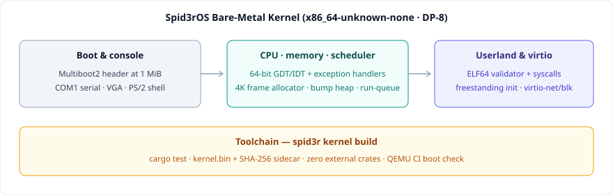

# Spid3rOS Bare-Metal Track (`R13` / `DP-8`)

> **Status:** `DP-8` chartered and `R13.1` bare-metal `kernel/` foundation + host-testable subsystems implemented; QEMU 10m/30m soak tests (`R13.2`/`R13.5`), live ring-3 `sysret` execution (`R13.6`), virtio-tap packet roundtrip (`R13.7`), and external `unsafe` review (`R13.8`) remain open until executed on Linux QEMU CI.

## Architecture



- **Workspace member (`kernel/`):** zero external crates (`kernel/Cargo.toml`), linked at `1 MiB` physical via [kernel/link.ld](../kernel/link.ld) with `-C disable-redzone=yes` and `-C relocation-model=static` ([kernel/.cargo/config.toml](../kernel/.cargo/config.toml)).
- **Boot (`kernel/src/boot.rs`, `kernel/src/main.rs`):** embeds the 24-byte Multiboot2 header (`0xE85250D6`) in `.multiboot2`, initializes COM1 (`0x3F8`) serial UART, emits `Spid3rOS v0.1 (x86_64 multiboot2) ready`, and idles via `hlt`.
- **Memory (`kernel/src/mem.rs`):** audited 4 KiB physical bitmap frame allocator (double-free refusal, exact frame accounting) + checked-arithmetic bump heap (`KernelBumpHeap`, clean error on exhaustion without integer wrap).
- **Interrupts & Console (`kernel/src/intr.rs`, `kernel/src/console.rs`):** 64-bit GDT/IDT descriptors, exception vector table (`#DE`, `#UD`, `#DF`, `#GP`, `#PF`), PS/2 scancode set 1 decoder, and `help`/`ps`/`meminfo` shell commands.
- **Userland & Syscall ABI (`kernel/src/user.rs`, `kernel/init/init.matrix`):** ELF64 x86-64 validator (`0x7F ELF`, `ELFCLASS64`, `EM_X86_64`) + documented syscall numbers (`SYS_WRITE = 1`, `SYS_GETPID = 39`, `SYS_EXIT = 60`). `kernel/init/init.matrix` targets the `R9.4` freestanding Spid3r build profile (`--freestanding --entry _start --target x86_64-unknown-none --emit-obj`).
- **Drivers (`kernel/src/drivers.rs`):** PCI Type-0 configuration address encoder (`0xCF8`) and modern virtio device classification (`virtio-net = 0x1041`, `virtio-blk = 0x1042`).

## Build & Verify

```sh
# Host unit tests for all kernel subsystems (Windows / Linux / macOS)
cargo test --manifest-path kernel/Cargo.toml

# Bare-metal x86_64-unknown-none kernel build + SHA-256 sidecar
rustup target add x86_64-unknown-none
spid3r kernel build
```
