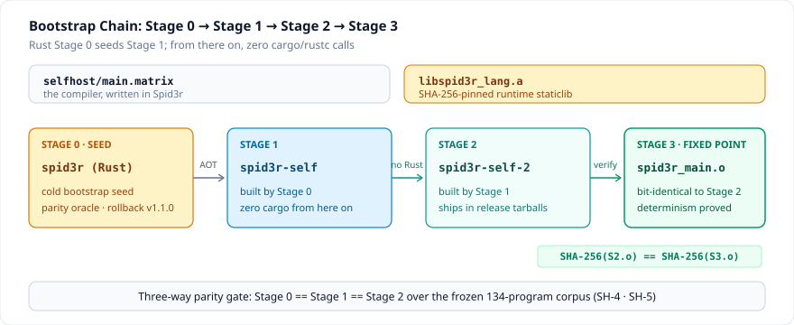
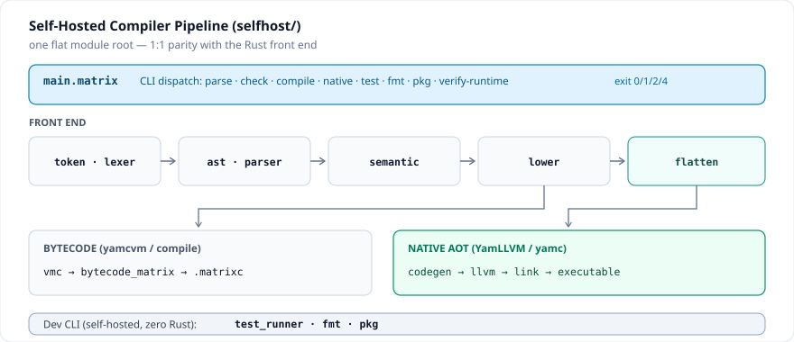
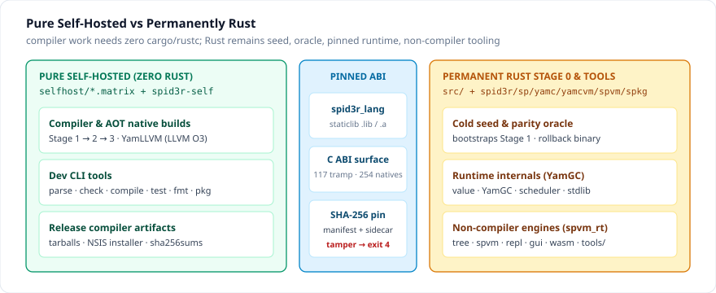

# Spid3r Self-Hosting Documentation & Diagrams

Everything documenting Spid3r's self-hosted compiler (`selfhost/`) lives in this directory.

## Short answer: does Spid3r run only on selfhost in the future?

- **For compiler & AOT release builds (`spid3r-self`):** **Yes.** Rebuilding the 17-module compiler (`selfhost/*.matrix`), formatting/checking/testing/packaging projects, and producing release compiler binaries runs purely on `spid3r-self` with zero `cargo` or `rustc` calls.
- **For the full repository:** **No — Rust Stage 0 (`src/`) stays permanently** as:
  1. The cold bootstrap seed and semantic parity oracle (`src/oracle.rs`, `SH-1`, `SH-5`),
  2. The SHA-256-pinned runtime staticlib (`src/native/rt.rs` + `src/stdlib/`, 75 trampolines & 257 stdlib natives, `SH-6`), and
  3. Non-compiler runtimes & host tooling (`tree`/`vm`, `repl`, `debug`, `lsp`, `doc`, `agent`, `gui`, `wasm32`, `plugin`, plus `tools/` harnesses, `SH-2`).

---

## Documents in this folder

| Document | Scope |
|---|---|
| [SELFHOST.md](SELFHOST.md) | Core architecture decision record (`SH-1`–`SH-8`): bootstrap chain, no-Rust boundaries, flat module layout, frozen corpus contract, parity discipline, runtime ABI choice, LLVM-C `ptr`/`usize` FFI, and rollback |
| [SELFHOST_RETIREMENT.md](SELFHOST_RETIREMENT.md) | Phase 10.2 (`SH-8`) architectural retirement review: exact Rust-free boundary vs permanently retained Rust surfaces, `v1.1.0` rollback path, and maintenance rules |
| [RUNTIME_ABI.md](RUNTIME_ABI.md) | Formal interface specification (`SH-6`, `SEC-B`): versioned `spid3r-runtime-<ver>-<target>.tar.gz` bundle, schema-1 provenance manifest, SHA-256 verification/exit-4 contract, 75 `spid3r_*` trampolines, and 257 stdlib natives |

Related cross-project references outside this folder:
- [../../implementation_plan.html](../../implementation_plan.html) — Active implementation roadmap & decision-point sign-offs
- [../NATIVE.md](../NATIVE.md) — Shared Rust & self-hosted LLVM AOT backend overview
- [../BUILDING.md](../BUILDING.md) — Building Stage 0 (`spid3r`) and bootstrapping Stage 1 (`selfhost/main_native.exe`)
- [../ENGINE_CONTRACT.md](../ENGINE_CONTRACT.md) — Three-engine semantic contract (`tree`, `vm`, `native`)
- [../html/benchmark.html](../html/benchmark.html) — Stage-0 vs selfhost throughput baselines & PGO/Arena/JIT comparison

---

## Diagrams (`diagrams/`)

### Bootstrap Chain & Fixed-Point Verification

### 17-Module Compiler & Dev CLI Architecture

### Permanent Rust vs Pure Self-Hosted Boundary

