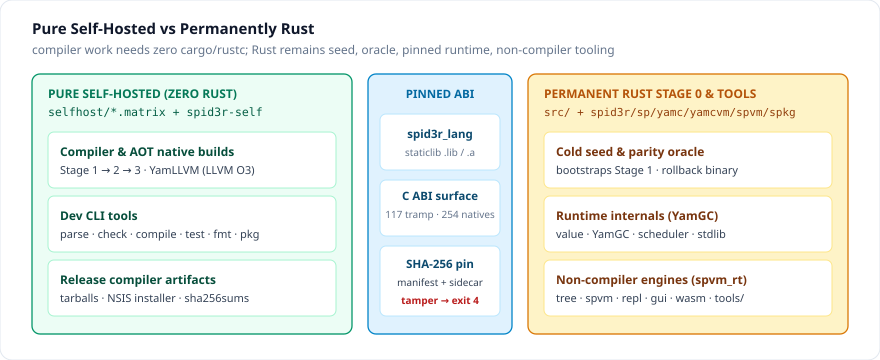

# Self-hosting retirement review (Phase 10.2, SH-8)

Status: **Adopted** (2026-11-15).

This document is the Phase 10.2 (`SH-8`) architectural retirement review for Spid3r's self-hosting program ([SELFHOST.md](SELFHOST.md)). It states honestly what compiler and developer-tool work no longer requires a Rust toolchain, what still requires Rust and why, how rollback works via Stage-0 release tags, and the maintenance rules for the self-hosted compiler going forward.

---

## 1. Summary verdict

The **“no Rust for future compiler builds”** milestone (`SH-2`) is **met within the documented boundary**:

- Given a compiled `spid3r-self` binary, the prebuilt SHA-256-pinned runtime staticlib (`spid3r_lang.lib` on Windows; `libspid3r_lang.a` on Linux/macOS), LLVM 23, and the platform linker (`link.exe` on Windows, `clang`/`cc` on Unix), modifying and rebuilding the Spid3r compiler (`selfhost/*.matrix`) and its CLI dev tools invokes **zero `cargo`/`rustc` processes**.
- The Stage-1 → Stage-2 → Stage-3 bootstrap reaches a **bit-identical** target object fixed point (`spid3r_main.o`), and [`tools/release_selfhost.sh`](../../tools/release_selfhost.sh) produces versioned runtime archives, platform release bundles, `sha256sums.txt`, and the Windows NSIS installer (`Spid3r-Setup-<version>.exe`) using `spid3r-self` as the compiler builder.

At the same time, Stage 0 (`src/`, Rust) is **not deleted** (`SH-8`): it stays permanently in the repository as the clean-bootstrap seed, semantic/differential oracle ([ENGINE_CONTRACT.md](../ENGINE_CONTRACT.md)), runtime staticlib producer (`SH-6`), and host for the retained developer/runtime tools (`SH-2`).

---

## 2. What no longer requires Rust (`spid3r-self`)

All 17 modules under `selfhost/` compile cleanly via `spid3r-self` without invoking `cargo` or `rustc`:

| Subsystem | Module(s) | Replaces Rust `cargo build` for |
|---|---|---|
| Frontend (Lex & Parse) | `token.matrix`, `lexer.matrix`, `lexer_json.matrix`, `ast.matrix`, `parser.matrix` | `src/lexer/`, `src/parser/` |
| Type checker & lints | `semantic.matrix` | `src/semantic/` |
| Lowering & bytecode compiler | `lower.matrix`, `vmc.matrix`, `bytecode_matrix.matrix` | `src/lower/`, `src/vm/compiler.rs`, `src/vm/bytecode.rs` (`serialize_vmfunc`) |
| Native LLVM-C backend | `llvm.matrix`, `codegen.matrix` | `src/native/ir.rs`, `src/native/llvm.rs` |
| Driver, flattening & linking | `flatten.matrix`, `link.matrix`, `main.matrix` | `src/native/modules.rs`, `src/native/link.rs` |
| Dev & package tooling | `test_runner.matrix`, `fmt.matrix`, `pkg.matrix` | `spid3r test`, `fmt`, `check` lints, `pack`, `unpack`, `verify`, `verify-runtime`, `dist` |

Release compiler binaries (`spid3r-self` / `spid3r-self.exe`), `spid3r-self` smoke verification, and Windows NSIS installer compiler packaging (`packaging/nsis/spid3r.nsi` driven by `tools/release_selfhost.sh`) all run with `spid3r-self` and prebuilt pinned runtime artifacts.

---

## 3. What still requires Rust (honest boundary)

Trying to pretend Rust is completely absent would misstate the system architecture. The exact components that still depend on `rustc`/`cargo` are:

### 3.1 Rebuilding the runtime staticlib (`SH-6`, Phase 9.2 ADR)
- **Files:** `src/native/rt.rs` (117 `spid3r_*` C-ABI trampolines), `src/stdlib/` (254 native entries), `src/value/mod.rs`, `src/gc/`, `src/sched/` (`crate-type = ["staticlib"]` → `spid3r_lang.lib` / `libspid3r_lang.a`).
- **Why:** By explicit owner-confirmed Phase 9.2 ADR ([SELFHOST.md](SELFHOST.md)), `rt.rs` remains in Rust inside the versioned, SHA-256-pinned runtime archive ([RUNTIME_ABI.md](RUNTIME_ABI.md)) to avoid duplicating low-level runtime internals across a second C ABI and to preserve a single semantic source of truth across tree/VM/AOT.
- **Impact on compiler work:** Normal compiler edits (`selfhost/*.matrix`) **never** rebuild the runtime staticlib. Rust is only needed when adding/changing stdlib builtins, GC/value internals, or `spid3r_*` trampolines.

### 3.2 Stage-0 bootstrap & semantic oracle (`SH-1`, `SH-5`)
- **Files:** `src/`, `src/oracle.rs` (`tokens --json`, `parse --dump-ast-json`, `parse --dump-lowered-json`, `check --dump-registry-json`).
- **Why:** Cold bootstrap on a fresh environment without a trusted `spid3r-self` executable starts from Stage 0 (`cargo build --features native`), and every parity harness compares `selfhost/` dumps and outputs against Stage 0 as the oracle.

### 3.3 Retained Rust-side runtime & optional developer tools (`SH-2`)
Explicitly excluded from the self-hosting compiler target in [SELFHOST.md](SELFHOST.md):
- Script engines & runtime commands (`spid3r` / `sp` plus additive `spvm` / `yamcvm` / `yamc` / `spkg` — `spvm_rt` tree/VM interpreters, `exec`, `disasm`, `verify-runtime`)
- Interactive tools (`repl`, VM line `debug`, `lsp`, `doc`, `control`, `bench`, `modules`, `init`/`add`/`remove`/`install`/`publish`/`search`)
- GUI host (`gui` feature via `wry`/`tao`, `spid3r-control.exe`) and WASM browser bundle (`wasm32-unknown-unknown` `cdylib` powering `web/`)
- Cross-target bootstrap convenience: on Linux, release tarballs bundle `libLLVM.so.23.1` under `lib/` and link `spid3r` / `spid3r-self` with `-Wl,-rpath,$ORIGIN:$ORIGIN/../lib`, plus 0-byte `sp`, `yamc`, `yamcvm`, `spvm`, `spkg -> spid3r` symlinks, so clean Linux hosts run out of the box without system `libllvm23`. On Windows, the NSIS installer ships `spid3r.exe`, `sp.exe`, `yamc.exe`, `yamcvm.exe`, `spvm.exe`, `spkg.exe`, `spid3r-self.exe`, `spid3r-control.exe`, `LLVM-C.dll` + `LLVM-C.lib` (**YamLLVM**), and SHA-256-pinned `spid3r_lang.lib` (**YamGC** + runtime trampolines), associating both `.matrix` and `.mt` files.

### 3.4 Verification & benchmark harnesses
- `tools/*.sh`, `tools/*.py`, `tools/*.js`, `tools/*.ps1` stay script-side tooling and do not ship in releases.

---

## 4. Rollback story (Stage 0 pinned by tag, `SH-8`)

Every commit keeps `src/` buildable and differential-tested (`tools/gate.sh` 9/9, `tools/difftest.sh` `ALL MATCH`).

- **Last fully-Rust-built Stage-0 release tag (pinned before Phase 10 switch):**
  - Tag **`v1.1.0`** → commit `ec9e98ccf0df11002fdb22759d89e94fb1142beb` (`3ded279`)
  - Earlier Stage-0 release tags: `v1.0.1` (`3837fd82f0efb7b066a026c75f61d628c4a08d83`), `v1.0.0` (`970bb6da36ac617bc86c98ba2bf78daa9f750b73`)
- **Rollback procedure (zero migration):**
  1. If a selfhost compiler or release pipeline regression escapes parity, revert the offending commits on `main` (or check out `v1.1.0` cleanly).
  2. Rebuild Stage 0 directly with Cargo:
     - Core: `cargo build --release --locked --no-default-features`
     - Native + GUI (Windows): `cargo build --release --locked --no-default-features --features gui,native,tls`
  3. On an emergency release tag, CI can fall back directly to Stage 0 `spid3r` without changing `.matrix` user programs or `.matrixc`/runtime contracts ([RUNTIME_ABI.md](RUNTIME_ABI.md) guarantees backward compatibility for pinned runtime staticlibs).

---

## 5. Maintenance rules going forward

All future compiler changes under `selfhost/` MUST obey the following rules before commit:

1. **Frozen corpus parity (`SH-4`, `SH-5`):**
   - `python tools/corpus_manifest.py verify` must report `137 files verified` (`136` programs + `MANIFEST.sha256`). Never mutate `selfhost/corpus/` without a documented `SH-4` ledger entry and `python tools/corpus_manifest.py build && verify`.
   - All frontend/backend parity harnesses must pass with zero regressions:
     `selfhost_lex_parity.sh`, `selfhost_parse_parity.sh`, `selfhost_semantic_parity.sh`, `selfhost_lower_parity.sh`, `selfhost_compile_parity.sh`, `selfhost_sandbox_parity.sh`, `selfhost_test_parity.sh`, `selfhost_fmt_check_parity.sh`, `selfhost_pkg_parity.sh`, `selfhost_runtime_parity.sh`, plus 3-way `selfhost_bootstrap_parity.sh` on native hosts.
2. **Fixed-point & release integrity (`SH-1`, `SEC-B`):**
   - Stage 1 → Stage 2 → Stage 3 `spid3r_main.o` SHA-256 must match bit-for-bit (`tools/release_selfhost.sh build`).
   - Release builds require pinned runtime verification (`SPID3R_RUNTIME_REQUIRE_PIN=1` + `runtime-manifest.json` / `.sha256`).
3. **Formatting & flat-namespace hygiene (`AGENTS.md` §6):**
   - Every edited `.matrix` file under `selfhost/` must pass `fmt --check`.
   - `selfhost/` forms one flattened top-level function namespace: prefix every module-private helper (`lex_`, `chk_`, `cg_`, `fl_`, `link_`, `fmt_`, `pkg_`) to prevent cross-module name collisions.
4. **Rust oracle & engine contract (`SH-8`):**
   - Changes touching Rust `src/` must additionally pass `tools/gate.sh` (9/9), `tools/difftest.sh` (`ALL MATCH`), `cargo fmt --all -- --check`, and `cargo clippy --all-targets --features native -- -D warnings`.
   - Changes touching `src/native/rt.rs` or `src/stdlib/` must update [RUNTIME_ABI.md](RUNTIME_ABI.md) trampoline/native counts (`tools/runtime_artifact.sh`) and re-verify `spid3r-self verify-runtime`.
